# Guía de diseño de A Medias

> Esta es la fuente de verdad visual de la app. Va en `docs/diseno.md`, y las imágenes de referencia van en `docs/diseno/`.
> Base: rama `develop`, commit `1caab7c` (1/11/2026, 21:34, hora de Catamarca), más los bocetos aprobados de Inicio de Finanzas (opción B y Amigable), Compartidos (v2 y Amigable) y la navegación por módulo, la paleta unificada del 2/11/2026 y las respuestas de Coty del 2/11/2026 (cuatro tandas, la última con la simplificación aprobada).
> Lo marcado **"Decisión de diseño (Art Attack)"** es firme: Coty delegó las decisiones de diseño y se implementa igual que lo aprobado. La sección 10 (simplificación, aprobada por Coty) es la regla vigente del encabezado y de la densidad: si algo de las secciones 4 y 5 choca con la 10, gana la 10. No quedan dudas de negocio abiertas (8.2).
> Si algo de esta guía choca con el código, gana la guía. Si algo no está acá, preguntale a Coty antes de inventarlo (ver la sección 8).

Índice: 1. Paleta · 2. Tipografía · 3. Íconos e ilustraciones · 4. Componentes · 5. Pantallas · 6. Reglas fijas · 7. Lo que hoy no cumple · 8. Preguntas y decisiones · 9. Navegación por módulo · 10. Simplificación (vigente) · 11. Pantallas simplificadas: Gastos, Avisos, Ahorros y Préstamos

Referencias visuales vigentes (sección 10, aprobada por Coty):

| Pantalla | Ancho 390 | Ancho 360 |
|---|---|---|
| Resumen (Inicio de Finanzas), Contable | 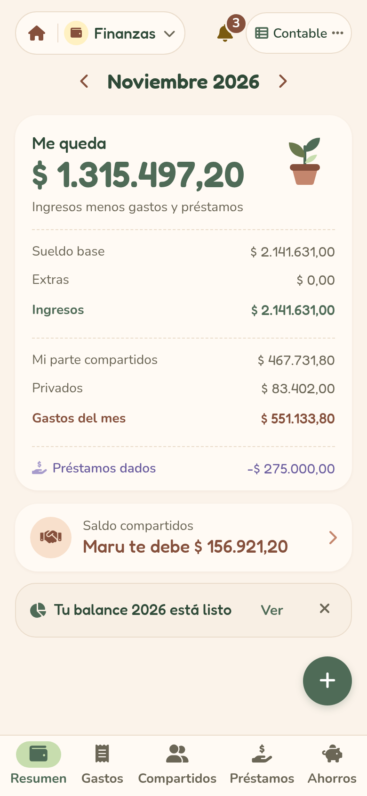 | 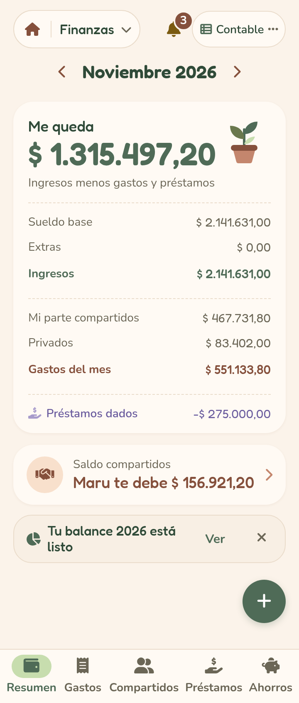 |
| Resumen (Inicio de Finanzas), Amigable | 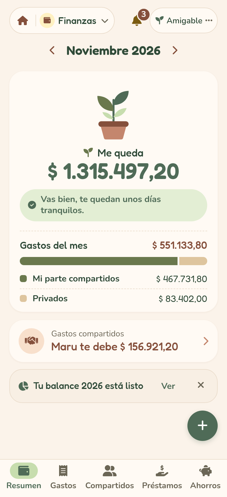 | 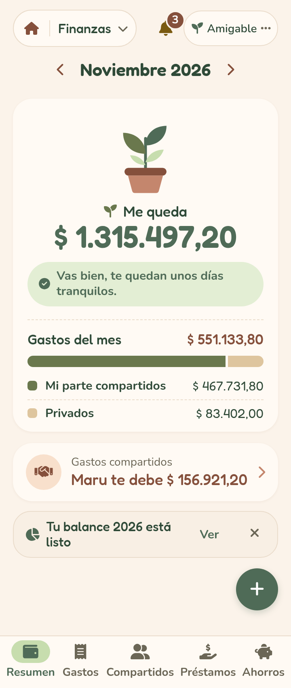 |
| Compartidos, Contable | 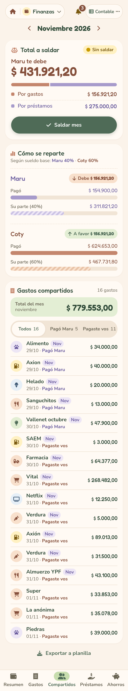 | 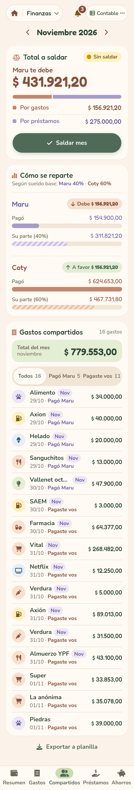 |
| Compartidos, Amigable | 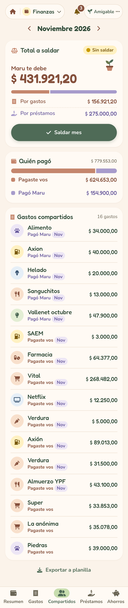 | 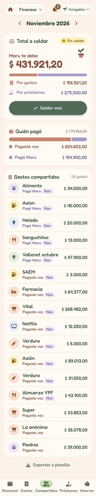 |
| Hoja "Opciones de vista" | 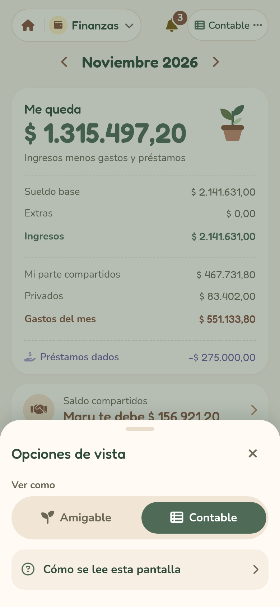 | — |
| Paleta y escala tipográfica (sin el rol `titulo-mes`, ver 2.2) | 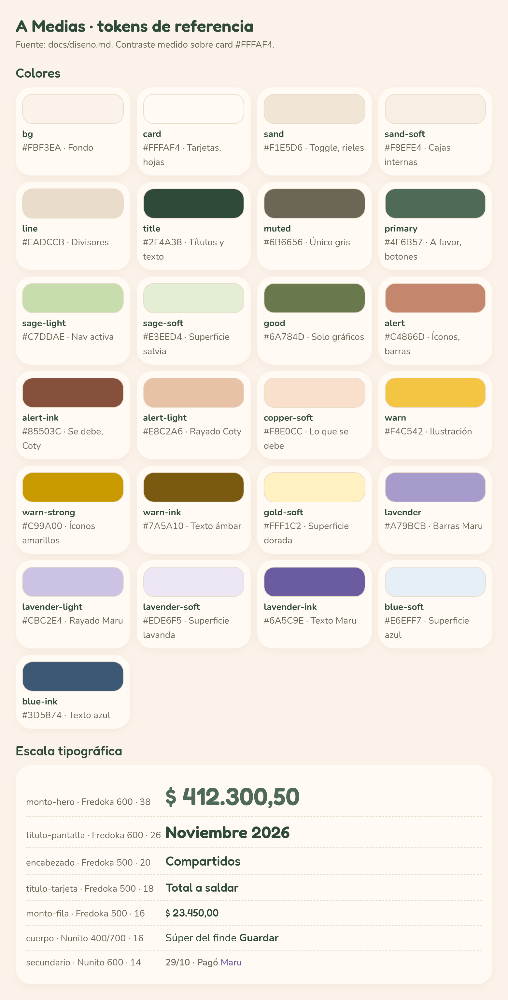 | — |
| Hoja "Ir a" (cambiar de módulo): vale la hoja, no el encabezado de atrás | 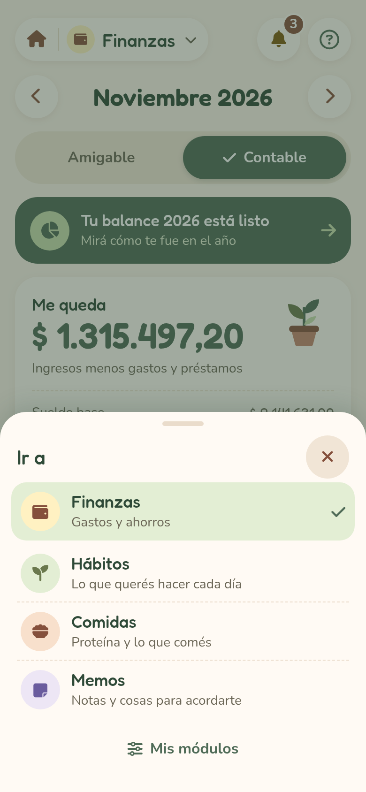 | 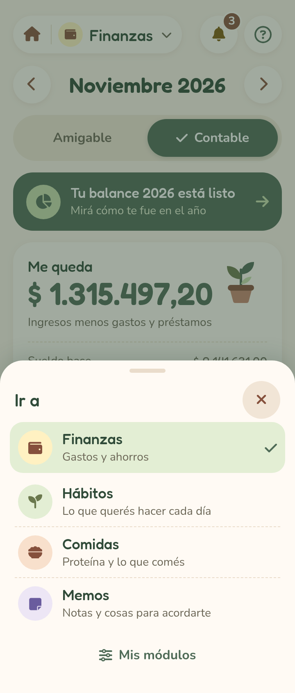 |
| Menú de cada módulo, segundo nivel y estados de la campana: vale el menú y el número, no el círculo de los botones | 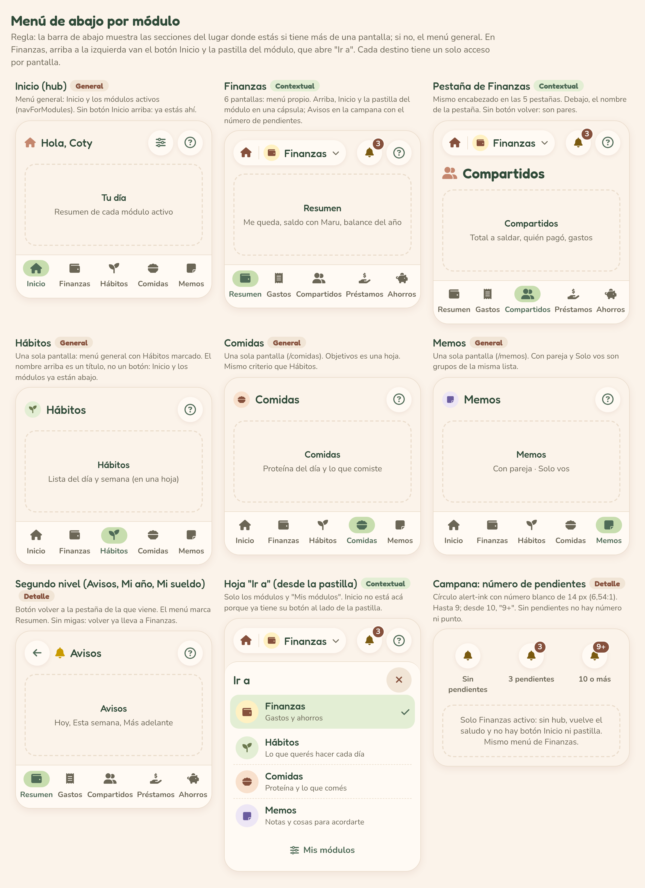 | — |
| Contenido de la ayuda (paneles): vale la hoja, ahora se abre desde Opciones | 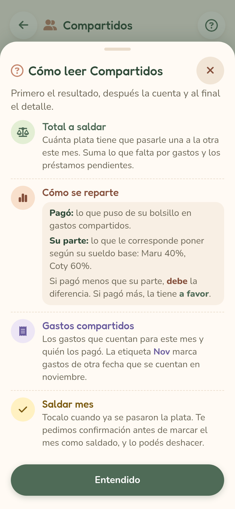 | 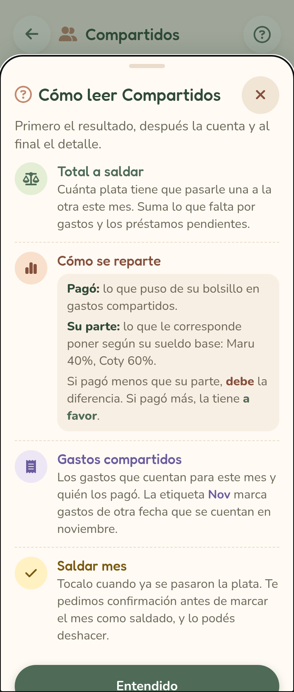 |
| Confirmar "Saldar mes": vale la hoja | 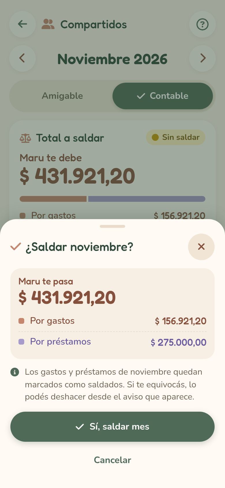 · 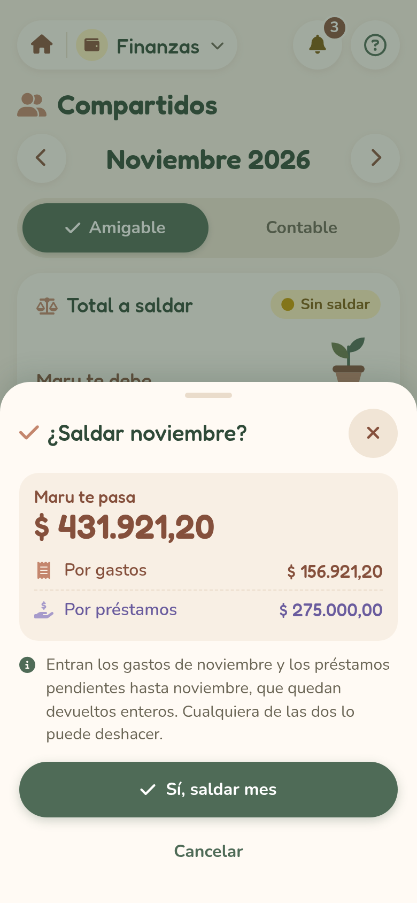 | 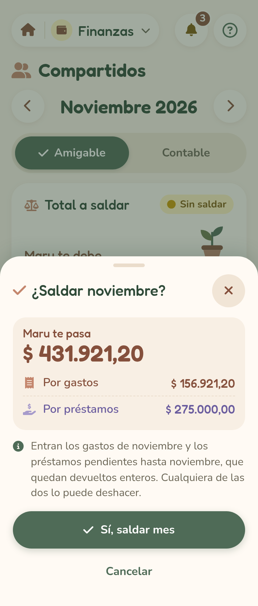 |
| Mes saldado con el aviso con deshacer (4.15, N20): vale la tarjeta y el aviso | 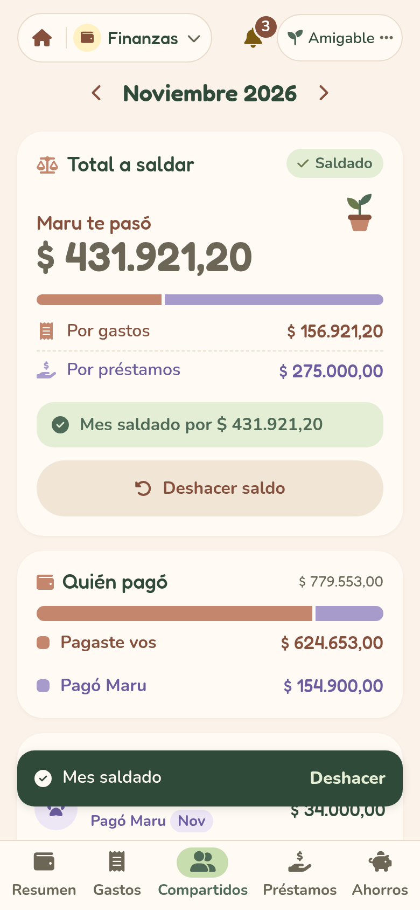 | 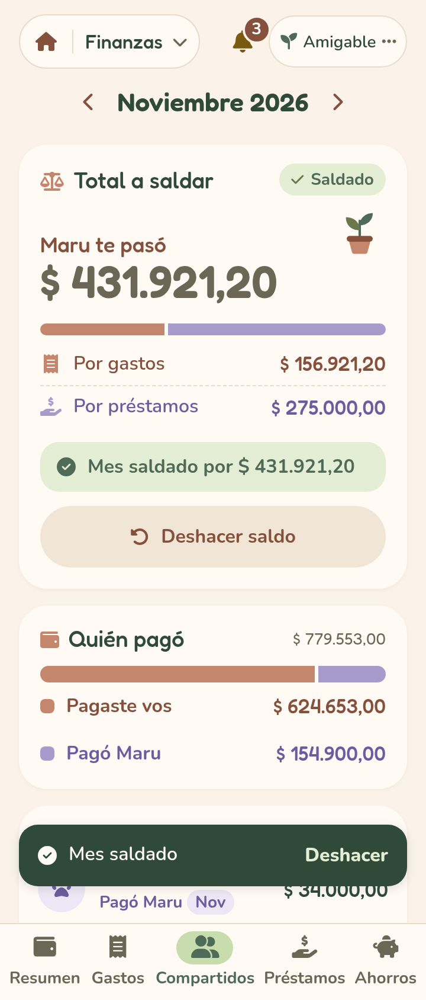 |

Las pantallas de la sección 11 (Gastos, formulario de carga, Avisos, Ahorros y Préstamos) tienen su tabla de imágenes ahí.

**Reemplazados** (se conservan como historia; no se usan como referencia del encabezado ni de la densidad): `inicio-finanzas-390.png`, `inicio-finanzas-360.png`, `inicio-finanzas-390-amigable.png`, `inicio-finanzas-360-amigable.png` → `resumen-*`; `compartidos-v2.png`, `compartidos-v2-360.png`, `compartidos-v2-arriba.png`, `compartidos-390-amigable.png`, `compartidos-360-amigable.png` → `compartidos-contable-*` y `compartidos-amigable-*`; `navegacion-finanzas-390.png`, `navegacion-finanzas-360.png` → `resumen-contable-*`; `simplificacion-resumen-390.png` y `simplificacion-compartidos-390.png` (comparativas previas a la aprobación, 10.4); de la sección 11, `s11-gastos-contable-*`, `s11-gastos-amigable-*` y `s11-tablero-gastos-*` → sus `-v2`; `s11-ahorros-amigable-*` → `s11-ahorros-v2-*`; `s11-prestamos-amigable-*` → `s11-prestamos-v2-*`; `s11-tablero-ahorros-*` y `s11-tablero-prestamos-*` → sus `-v2`. Con las respuestas S15 a S19: `s11-ahorros-v2-*` → `s11-ahorros-archivados-plegado-v3-*`; `s11-ahorros-menu-*` → `s11-ahorros-menu-archivar-v3-*`; `s11-ahorros-borrar-*` → `s11-ahorros-confirmar-archivo-v3-*` (ya no se borra, S19); `s11-tablero-ahorros-v2-*` → `s11-tablero-ahorros-v3-*`; `s11-gasto-form-390/360` → `s11-gasto-form-nuevo-v3-*`; `s11-tablero-form-*` → `s11-tablero-form-v3-*`. En `s11-tablero-gastos-v2-*`, la nota "provisional hasta que Coty responda 11.6" quedó vieja: el total ya está decidido (S15). Con S20 a S25 y el aviso con deshacer (N20): `compartidos-saldado-390-amigable.png` y `compartidos-saldado-360-amigable.png` → `compartidos-saldado-aviso-v4-*` (el aviso tenía el estilo anterior); `s11-ahorros-toast-archivo-v3-*` → `s11-ahorros-aviso-archivado-v4-*`; `s11-gasto-form-nuevo-v3-*` → `s11-gasto-form-nuevo-v4-*`; `s11-tablero-form-v3-*` → `s11-tablero-form-v4-*`; `s11-tablero-ahorros-v3-*` → `s11-tablero-ahorros-archivar-v4-*` y `s11-tablero-ahorros-restaurar-v4-*`.

**Descartados** (Coty dejó Ahorros y Préstamos solo en Amigable, S11; no se implementan): `s11-ahorros-contable-390.png`, `s11-ahorros-contable-360.png`, `s11-prestamos-contable-390.png` y `s11-prestamos-contable-360.png`.

En los bocetos de navegación, el lugar del botón Inicio, el color de Finanzas (`gold-soft`) y la forma del número de la campana son decisiones de diseño (Art Attack, 8.1).

---

## 1. Paleta

Todos los colores salen de `tailwind.config.ts` (`theme.extend.colors`). **No se escriben hex sueltos en los componentes**; si falta un color, primero se agrega como token acá y en la config.
El contraste se mide sobre `card` #FFFAF4 y sobre `bg` #FBF3EA. "Estado" compara contra `develop`.

### 1.1 Superficies y líneas

| Token | Hex | Uso | Estado |
|---|---|---|---|
| `bg` | #FBF3EA | Fondo de pantalla | Existe |
| `shell` | #EFE3D4 | Lienzo exterior (escritorio, fuera de los 430 px) | Existe |
| `card` | #FFFAF4 | Tarjetas, hojas, barra de navegación | Existe |
| `sand` | #F1E5D6 | Fondo del toggle y de los filtros, botón secundario, riel de las barras, botón cerrar de la hoja | Existe |
| `sand-soft` | #F8EFE4 | Cajas con texto adentro de una tarjeta (definiciones, resumen de la confirmación) | **Nuevo** |
| `line` | #EADCCB | Divisores, bordes de input y manija de la hoja | Existe (absorbe #E8DCCB, #EFE2D3, #E6D6C4) |

### 1.2 Texto

| Token | Hex | Uso | Contraste card / bg | Estado |
|---|---|---|---|---|
| `title` | #2F4A38 | Títulos de pantalla, tarjeta y hoja, y **también el texto común** | 9.38 / 8.86 | **Nuevo** (reemplaza a `text` #202808) |
| `muted` | #6B6656 | **El único gris**: etiquetas, secundarios, nav y toggle inactivos, tachados, desactivados | 5.53 / 5.22 | Existe (absorbe #8A8370, #A49C88, #6F5C50, #8A776A) |
| `on-primary` | #FFFFFF | Texto e íconos sobre `primary` | 5.88 sobre primary | **Nuevo** |
| `text` | — | Se retira. Mientras haya clases `text-text`, el token tiene que valer #2F4A38 | — | Cambia |

### 1.3 Salvia (a favor, acción principal)

| Token | Hex | Uso | Notas |
|---|---|---|---|
| `primary` | #4F6B57 | Botón principal, FAB, nav activa, link, **montos a tu favor y positivos** | 5.66 / 5.35 |
| `sage-light` | #C7DDAE | Píldora de la nav activa, hoja clara de la planta | **No va como fondo de texto chico** (primary encima: 4.03) |
| `sage-soft` | #E3EED4 | Superficie salvia: círculo de ícono, chip "A favor", caja "Total del mes" | primary encima: 4.88. **Nuevo** |
| `good` | #6A784D | **Solo para gráficos e ilustraciones**: ícono de Ahorros, hojas, puntos de progreso | **Nunca** como texto |

### 1.4 Cobre (lo que se debe, Coty)

| Token | Hex | Uso | Notas |
|---|---|---|---|
| `alert` | #C4866D | Íconos, barras, maceta | No es texto (2.90) |
| `alert-ink` | #85503C | **Montos que se deben**, nombre de Coty, errores, subtítulo de ayuda "Cómo se reparte" | 6.30 / 5.95 |
| `alert-light` | #E8C2A6 | Rayado "Su parte" de Coty en "Cómo se reparte" | **Nuevo** (reemplaza a `blush`) |
| `copper-soft` | #F8E0CC | Durazno de **lo que se debe**: chip "Debe", ícono del saldo, superficie de las categorías cobre | alert-ink encima: 5.15. **Nuevo** |
| `blush`, `debt` | — | **Se eliminan** (eran rosa) | `blush` pasa a `alert-light` y `debt` a `copper-soft` |

### 1.5 Amarillo (avisos, estado pendiente)

| Token | Hex | Uso | Notas |
|---|---|---|---|
| `warn` | #F4C542 | Amarillo de marca en ilustraciones (sol, flor) | No es texto (1.57) |
| `warn-strong` | #C99A00 | Íconos amarillos que tienen que verse (Avisos, punto de "Sin saldar") | Siempre con texto al lado (2.50). **Nuevo** |
| `warn-ink` | #7A5A10 | Texto ámbar: "Sin saldar", "Avisos", subtítulo de ayuda "Saldar mes" | 6.14 (5.64 sobre gold-soft). **Nuevo** |
| `warn-soft` | #DEC59E | Arena tostada: segmento **Privados** de la barra de gastos (aprobado por Coty, 4.8), borde de la maceta, detalles | No es texto (1.61 sobre `card`) |
| `gold-soft` | #FFF1C2 | Superficie dorada: íconos, chip "Sin saldar" | **Nuevo** como token |

### 1.6 Lavanda (Maru, préstamos)

| Token | Hex | Uso | Notas |
|---|---|---|---|
| `lavender` | #A79BCB | Barras y puntos de Maru y de los préstamos | No es texto (2.47) |
| `lavender-light` | #CBC2E4 | Rayado "Su parte" de Maru en "Cómo se reparte" | **Nuevo** |
| `lavender-soft` | #EDE6F5 | Superficie lavanda: círculo de ícono, chip "Nov", memo compartido | lavender-ink encima: 4.74. **Nuevo** |
| `lavender-ink` | #6A5C9E | **Texto de Maru** y de los préstamos | 5.56 / 5.25. **Nuevo** (unifica #5F548C, #5C5180, #5C4E86, #7E70AE y #2C2440) |

### 1.7 Azul (categorías de servicios y tecnología)

| Token | Hex | Uso | Notas |
|---|---|---|---|
| `blue-soft` | #E6EFF7 | Superficie azul (wifi, notebook) | **Nuevo** |
| `blue-ink` | #3D5874 | Ícono y texto sobre blue-soft | 6.34 sobre blue-soft. **Nuevo** |

### 1.8 Significado fijo del color

| Qué | Color |
|---|---|
| Monto que alguien debe, gasto que te resta | `alert-ink` (texto), `copper-soft` (fondo), `alert` (barra) |
| Monto a tu favor, ingreso, lo que te queda | `primary` |
| Maru | texto `lavender-ink`, barra `lavender` |
| Coty | texto `alert-ink`, barra `alert` |
| Préstamos | texto `lavender-ink`, barra `lavender` (como en el boceto de Compartidos) |
| Gastos compartidos / privados (barra de gastos) | compartidos `good` (salvia); privados `warn-soft` (arena tostada). Aprobado por Coty (P19) |
| Número de avisos pendientes (campana) | círculo `alert-ink` con el número en `on-primary` (6.54:1). **Decisión de diseño (Art Attack).** |
| Pendiente o aviso | `warn-ink` sobre `gold-soft`, ícono `warn-strong` |
| Error | `alert-ink`, con ícono y texto (nunca solo color) |

El nombre de cada persona se pinta con su color **siempre**: en subtítulos ("Pagó **Maru**"), en "Cómo se reparte" y en las filas.

### 1.9 Sombras y radios

| Token | Valor | Uso |
|---|---|---|
| `shadow-card` | `0 4px 14px #c4866d18` | Tarjetas |
| `shadow-soft` | `0 3px 8px #c4866d22` | Botones redondos, teclas |
| `shadow-fab` | `0 8px 18px #4f6b5766` | FAB (sombra salvia) |
| Radio de tarjeta | `rounded-3xl` (24 px) | Tarjetas, banner, filas sueltas |
| Radio de hoja | `rounded-t-[28px]` | Hojas (boceto de ayuda) |
| Radio de control | `rounded-full` | Botones, chips, toggle, filtros, píldoras |
| Radio de input | `rounded-2xl` (16 px) | Inputs y teclas del teclado numérico |
| Círculo de ícono | `rounded-full` | 36, 40 o 44 px (ver 3.2) |

---

## 2. Tipografía

### 2.1 Fuentes

| Familia | Token | Para qué |
|---|---|---|
| **Fredoka** | `font-display` | Títulos, nombre del mes, montos |
| **Nunito** | `font-sans` (default) | Todo lo demás: cuerpo, etiquetas, botones, chips, nav |

### 2.2 Escala

Esta escala consolida lo que hay en `develop` (10, 11, 11.5, 12, 12.5, 13, 13.5, 15, 15.5, 17, 19, 22, 1.7rem, 1.75rem, 1.8rem, 2xl, 3xl, 4xl y 44 px) y lo que piden los bocetos. **Base: 16 px. Mínimo: 14 px.** No hay tamaños intermedios: si un tamaño no está en la tabla, no se usa.

| Rol | Fuente · peso | Tamaño / interlineado | Clase Tailwind | Dónde |
|---|---|---|---|---|
| `monto-hero` | Fredoka 600 | 38 / 1.05 | `font-display text-[38px] font-semibold leading-none` | La cifra clave de la pantalla ("Me queda", "Total a saldar") y el monto que se está cargando |
| `titulo-pantalla` | Fredoka 600 | 26 / 1.2 | `font-display text-[26px] font-semibold` | h1 de pantalla sin selector: "Mis memos", "Mi sueldo" |
| `titulo-mes` | Fredoka 600 | 22 / 1.2 | `font-display text-[22px] font-semibold` | h1 del selector de período: mes, semana, día, año (4.3). **Aprobado por Coty** (sección 10) |
| `monto-tarjeta` | Fredoka 600 | 26 / 1.2 | igual | El monto de una tarjeta secundaria ("Total del mes", monto de un préstamo o un ahorro) |
| `encabezado` | Fredoka 500 | 20 / 1.25 | `font-display text-xl font-medium` | Encabezado con ícono ("Compartidos", "Hola, Coty") y título de hoja |
| `titulo-tarjeta` | Fredoka 500 | 18 / 1.3 | `font-display text-lg font-medium` | h2 de tarjeta, frase-resultado ("Maru te debe"), nombre de persona |
| `monto-fila` | Fredoka 500 | 16 / 1.3 | `font-display text-base font-medium` | Montos dentro de listas y desgloses |
| `cuerpo` | Nunito 400 | 16 / 1.5 | `text-base` | Texto común, filas, inputs |
| `cuerpo-fuerte` | Nunito 700 | 16 / 1.4 | `text-base font-bold` | Botones, título de fila, toggle |
| `secundario` | Nunito 600 | 14 / 1.4 | `text-sm font-semibold` | Etiquetas, subtítulos de fila, chips, nav, hints, leyendas |

Cuando se pasen los bocetos a código, sus tamaños sueltos se redondean así: 15 → 16, 17 → 18, 19 → 18 y 21 → 20. El nombre del módulo en la cápsula va en Fredoka 500 de 16 px (como `monto-fila`) para que el encabezado entre a 360 px (10.2). Hay que volver a comprobar a 360 px que los montos sigan en un renglón.

### 2.3 Pesos y jerarquía

- Se usan **Nunito 400, 600 y 700**, y **Fredoka 500 y 600**. `font-extrabold` (800) **no se usa**.
- **Solo la cifra clave es fuerte**: en cada tarjeta, como mucho un elemento en Fredoka 600. El resto de los montos van en Fredoka 500 o 400.
- La jerarquía se arma con **tamaño, color y espacio**, no con negrita. En una fila, el título va en 700 y el subtítulo en 600 `muted`; el monto, en Fredoka 500.
- El texto nunca es negro ni todo negrita: títulos y cuerpo en `title`, secundarios en `muted`, y montos en `primary` o `alert-ink` según el significado.
- Los montos llevan `whitespace-nowrap` y `tabular-nums`, y se formatean con `formatMoney` (`$ 1.234,56`).

---

## 3. Íconos e ilustraciones

### 3.1 Estilo

- **Font Awesome Solid** (`@fortawesome/free-solid-svg-icons`), siempre a través de `AppIcon` (`src/components/AppIcon.tsx`). No se usan Brands ni emojis como ícono.
- **Única excepción, aprobada por Coty:** el "?" de ayuda usa `circle-question` **Regular** (con contorno, `@fortawesome/free-regular-svg-icons`), como en el boceto. Ningún otro ícono va en Regular.
- Un ícono va con texto al lado o con un `aria-label`. Si es decorativo, `aria-hidden`.
- Tamaños: 14 px junto a un texto `secundario`, 16 px junto al cuerpo, 18 px dentro de un círculo de 36 a 40 px, 20 px en los botones redondos de 44 a 48 px y 24 px en el FAB.

### 3.2 Círculo de fondo

| Tamaño | Uso |
|---|---|
| 36 px | Categoría en una fila de lista (ExpenseLine, "Gastos compartidos") |
| 40 px | Encabezado de cada panel de la hoja de ayuda, ícono del saldo |
| 44 px | Fila de Avisos, de Comidas o del hub |

Superficie y tinta (vienen de `src/lib/icons.ts:194–198`, ya con la paleta nueva):

| Tono | Fondo | Ícono | Categorías (`iconSurface`) |
|---|---|---|---|
| Salvia (default) | `sage-soft` | `primary` | todas las que no están abajo |
| Cobre | `copper-soft` | `alert-ink` | fire, gas-pump, heart, pills, stethoscope |
| Dorado | `gold-soft` | `alert-ink` | lightbulb, bolt |
| Azul | `blue-soft` | `blue-ink` | wifi, laptop |
| Lavanda | `lavender-soft` | `lavender-ink` | book, graduation-cap, music, star |

### 3.3 Un ícono por sección

| Sección | Ícono FA | Color del ícono | Color del texto | Fuente |
|---|---|---|---|---|
| Inicio | `house` | `alert` con texto al lado; `alert-ink` cuando va solo (botón Inicio de las migas, 4.24: `alert` no llega a 3:1) | `title` | `lib/modules.ts`, boceto |
| Finanzas | `wallet` | `alert-ink` sobre `gold-soft` (5.8:1). Color: **Decisión de diseño (Art Attack).** | `title` | `MODULE_META`; `Sprout.tsx:5` ya usa #FFF1C2 (`gold-soft`) |
| Gastos | `receipt` | `alert` | `alert-ink` | `FINANCE_NAV`, boceto |
| Préstamos | `hand-holding-dollar` | `lavender` | `lavender-ink` | `FINANCE_NAV`, boceto |
| Ahorros | `piggy-bank` | `good` | `primary` | `FINANCE_NAV`, boceto |
| Avisos | `bell` | `warn-strong` con texto al lado; `warn-ink` cuando va solo (campana del encabezado, sección 9: `warn-strong` da 2.5:1 y no llega a 3:1) | `warn-ink` | `FINANCE_NAV`, boceto |
| Compartidos | `user-group` | `alert` | `title` | `SharedScreen.tsx:115`, boceto |
| Mi año | `chart-pie` | `sage-light` sobre `primary` | — | banner del boceto |
| Hábitos | `seedling` | `good` sobre `sage-soft` | `title` | `MODULE_META`; color aprobado por Coty |
| Comidas | `bowl-food` | `alert-ink` sobre `copper-soft` | `title` | `MODULE_META`; color aprobado por Coty |
| Memos | `note-sticky` | `lavender-ink` sobre `lavender-soft` | `title` | `MODULE_META`; color aprobado por Coty |
| Ayuda | `circle-question` **Regular** (única excepción a Solid) | `primary` sobre `card` | — | boceto; aprobado por Coty |
| Ajustes de Avisos ("Mis recordatorios") | `gear` | `primary` | — | Aprobado por Coty (P13) |
| Resumen de Finanzas (primera pestaña del menú de Finanzas) | `wallet` | `primary` si está activo, `muted` si no | — | Nombre aprobado por Coty (sección 9) |
| Filtros | `sliders` | `primary` | — | Gastos y Avisos |

**Color de cada módulo:** Hábitos `sage-soft`, Comidas `copper-soft` (reemplaza al rosa #FCE6EA) y Memos `lavender-soft`, aprobados por Coty. **Finanzas: `gold-soft` con el ícono en `alert-ink`.** **Decisión de diseño (Art Attack).** Por qué:
- No choca con Hábitos: es amarillo y no verde, y los cuatro módulos quedan en cuatro familias distintas (dorado, salvia, cobre y lavanda).
- Es el que ya usa el brote de Finanzas en el hub (`Sprout.tsx:5`, #FFF1C2), así que no hay que cambiar el hub ni sumar un token.
- El ícono va en `alert-ink` (5.8:1 sobre `gold-soft`) y no en `warn-ink`, para que la pastilla no se lea como el chip "Sin saldar" ni como la campana, que usan `warn-ink`.
- Se descartó `blue-soft`: ya es el tono de las categorías de servicios (3.2) y no tiene relación con la plata.

Se usa en el fondo del brote del hub (`Sprout.tsx:4–9`), en el círculo de la pastilla de módulo y del título de módulo (4.24) y en la hoja "Ir a".

### 3.4 Un ícono por categoría (`ICON_CHOICES`, `src/lib/icons.ts`)

| Ícono | Nombre | Ícono | Nombre | Ícono | Nombre |
|---|---|---|---|---|---|
| cart-shopping | Súper | pizza-slice | Comida | utensils | Restaurant |
| mug-hot | Café | bus | Colectivo | car | Auto |
| gas-pump | Nafta | plane | Avión | house | Hogar |
| building | Edificio | couch | Sillón | lightbulb | Luz |
| bolt | Energía | fire | Gas | wifi | Internet |
| shirt | Ropa | bag-shopping | Compras | gift | Regalo |
| champagne-glasses | Salidas | umbrella-beach | Playa | heart | Cuidado |
| stethoscope | Salud | pills | Farmacia | dumbbell | Deporte |
| paw | Mascota | graduation-cap | Estudio | book | Curso |
| laptop | Notebook | piggy-bank | Ahorro | star | Otro |

Sin categoría: `tag` (`DEFAULT_ICON`). Una categoría tiene **un solo** ícono; no se repiten íconos entre categorías.

### 3.5 La plantita y las ilustraciones

- La **plantita** es el motivo de la app: muestra el estado (Me queda, Ahorros, Hábitos, módulos del hub). Componentes: `Plant`, `PotPlant` y `plantStage` (`src/components/Plant.tsx`); `Sprout`, `HubPlant`, `DaySprout` y `Planter` (`src/components/Sprout.tsx`).
- Son **planas y sin contorno**: solo formas rellenas (`fill`), sin `stroke` alrededor de una forma, sin líneas punteadas, sin degradados y sin sombras. El tallo es un `rect` redondeado relleno, como en el boceto de Inicio.
- Usan solo tokens: tallo `primary`, hojas `good`, `primary` y `sage-light`, maceta `alert` con borde `alert-ink` o `warn-soft`, sol y flor `warn`, flor lila `lavender`. Sin rosa.
- Tamaños: 120 px en el Amigable, 64 px adentro de una tarjeta ("Me queda", Comidas), de 44 a 58 px en las filas.
- Siempre llevan `role="img"` y `aria-label` con el estado ("Plantita frondosa"), o `aria-hidden` si hay texto al lado que dice lo mismo.
- Los estados vacíos usan una ilustración chica (`SoftEmpty`, Gastos) más el título y la acción; nunca solo texto gris.
- **Aprobado por Coty.** Las hojas del brote de Hábitos van **rellenas** también cuando el hábito está pendiente, en `sage-light` (hoy son punteadas, `Sprout.tsx:74`). La semilla de `PotPlant` (#A07F5A) pasa a cobre, `alert`.

---

## 4. Componentes reutilizables

Convenciones de esta sección: **Existe** = está en `develop` (con su ruta). **Ajustar** = existe, pero hay que adaptarlo a la guía. **Crear** = todavía no existe.
Estados que tienen que estar contemplados en cada componente: vacío, cargando, error y desactivado. Lo desactivado va en `muted` y `opacity-60` y nunca se usa como única señal: también se explica por qué está desactivado.

### 4.1 Card · Ajustar · `src/components/ui.tsx:7–9`

- **Anatomía:** encabezado opcional (ícono en círculo de 36 px y h2 `titulo-tarjeta`, con un aside a la derecha), cuerpo y una acción opcional al pie.
- **Medidas:** `rounded-3xl`, `p-4` (16 px), separación de 14 px entre tarjetas (`mb-3.5`), `shadow-card`, fondo `card`.
- **Variantes:** `banner` (fondo `primary`, texto `on-primary`, ícono `sage-light`, para Mi año) y `soft` (fondo `sand-soft`, para cajas adentro de otra tarjeta). Las tarjetas no llevan fondos de color fuera de estas variantes.
- **Estados:** si está cargando, el monto se reemplaza por "Cargando…" en `muted` y la altura se mantiene. Si hay error, va una línea en `alert-ink` con ícono `circle-exclamation` y "Reintentar". Si está vacía, ilustración, título y acción.

### 4.2 ViewToggle (Amigable / Contable) · Ajustar · `src/components/ViewToggle.tsx`

**Aprobado por Coty (sección 10):** el toggle ya no va en la pantalla. Vive en la hoja **"Opciones de vista"** (4.26) como "Ver como", y el modo activo se ve siempre en el botón Opciones del encabezado.

- **Anatomía (en la hoja):** etiqueta "Ver como" (14 px `muted`, Nunito 700), riel `sand` `rounded-full` con `p-[3px]` y dos segmentos a lo ancho: "Amigable" con `seedling` y "Contable" con `table-list`. El activo en `primary` con texto `on-primary`, sin sombra.
- **Medidas:** segmentos de 44 px de alto, texto 16 px Nunito 700; el inactivo en `muted`.
- **Dónde está disponible:** en las pantallas de Finanzas con montos que hoy tienen las dos vistas: Resumen, Gastos, Compartidos y Mi año. **Avisos no lo lleva** (aprobado por Coty), y tampoco el hub, Hábitos, Comidas ni Memos. **Préstamos y Ahorros quedan solo en Amigable** (aprobado por Coty, S11): no tienen selector y se ven en Amigable aunque el modo guardado sea Contable.
- **Comportamiento:** `role="radiogroup"` con `role="radio"` y `aria-checked`. Al elegir, la pantalla cambia al instante y la hoja queda abierta (se cierra con la X, el scrim o Esc). Guarda la preferencia en el perfil (`me.viewMode`) y es la misma para todas las pantallas.
- **Estados:** si está desactivado mientras guarda, baja la opacidad sin mover el layout.

### 4.3 Selector de mes · Ajustar · `src/components/MonthSwitcher.tsx`

- **Anatomía:** flecha ‹, h1 con el mes (`titulo-mes`, 22 px) y flecha ›, **pegadas al título y centradas** (sección 10). Abajo, "Hoy" cuando no estás en el mes actual: se queda **debajo del mes**, como en `develop` (aprobado por Coty).
- **Medidas:** flechas de 44 × 44 **sin círculo ni sombra**, `chevron` de 16 px en `alert-ink` (6.3:1 sobre `bg`), 2 px entre flecha y título. El h1 va centrado y no se corta. Aprobado por Coty (sección 10).
- **Reuso:** Hábitos (semana) y Comidas (día) tienen hoy su propia copia (`HabitsScreen.tsx:150–157`, `MealsScreen.tsx:162–182`). Hay que **crear `PeriodSwitcher`** con `label`, `onPrev`, `onNext`, `canPrev`, `canNext` y `onToday`, y que `MonthSwitcher` lo use.
- **Estados:** si no hay período anterior o siguiente, la flecha queda desactivada (`opacity-40`), con `aria-disabled` y un `aria-label` que lo dice.

### 4.4 Barra segmentada de secciones · Retirada (aprobado por Coty)

- **No se implementa.** Coty aprobó el menú de abajo por módulo (sección 9): Gastos, Compartidos, Préstamos y Ahorros están en el menú de Finanzas y Avisos en la campana del encabezado. La barra repetiría esos accesos en la misma pantalla (R29).
- Lo que hay que borrar en `develop` es la fila de `FINANCE_SECTION_LINKS` (`HomeScreen.tsx:119–`, ver A15). El boceto opción B (`inicio-finanzas-390.png`) sigue valiendo para el resto de la pantalla, sin la barra.

### 4.5 FilterBar · Ajustar · `src/components/ui.tsx:29–49`

- **Anatomía:** control segmentado, igual al de "Gastos compartidos" del boceto: riel `sand`, 2 o 3 opciones a lo ancho y el conteo entre paréntesis.
- **Medidas:** `min-h-11` (44 px), 14 px Nunito 700, activo en `primary` / `on-primary`.
- **Regla:** **sin `overflow-x-auto`.** Si las opciones no entran en un renglón a 360 px, pasan a la hoja de filtros (`FilterSheet`).

### 4.6 Hoja de filtros · Ajustar · `src/components/FilterSheet.tsx`

- Tiene que montarse sobre `Sheet`, en lugar de reimplementar el portal, el scrim y la manija (`FilterSheet.tsx:177–205`).
- El botón que la abre es un círculo de 44 px con `sliders` en `primary`. Si hay filtros activos, se pinta `primary` y lleva un badge con el número (14 px, no 12).
- El pie lleva "Aplicar" (principal) y "Limpiar" (secundario).

### 4.7 Chips · Ajustar · `src/components/ui.tsx:51–75` (Chip), `ScopeChips`, `PaidChips`

- **Chip de selección:** `min-h-11`, `rounded-full`, 14 px Nunito 700. Inactivo con borde `line`, fondo `card` y texto `title`; activo con fondo `primary`, texto `on-primary` y check. Se acomodan con `flex-wrap`, nunca con scroll.
- **Chip de estado** (no interactivo, 14 px Nunito 700, `rounded-full`, `px-2.5 py-1`):

| Estado | Fondo | Texto | Ícono |
|---|---|---|---|
| Debe | `copper-soft` | `alert-ink` | `arrow-down` |
| A favor | `sage-soft` | `primary` | `arrow-up` |
| Sin saldar | `gold-soft` | `warn-ink` | punto `warn-strong` |
| Mes ("Nov") | `lavender-soft` | `lavender-ink` | — |
| Solo vos | `sand` | `title` | `lock` |
| Las dos | `lavender-soft` | `lavender-ink` | `user-group` |

- Reemplaza a `PeriodTag` (`ExpenseLine.tsx:16–22`, de 10 px) y a `AudiencePill` (`SectionHeader.tsx:26–32`, de 13 px).

### 4.8 Barras · Ajustar · `src/components/ui.tsx:77–84` (Progress)

- **Progreso:** riel `sand` de 10 px (`h-2.5`), `rounded-full`, relleno de un color con significado (1.8). Siempre va con su número en texto al lado.
- **Barra dividida** ("Total a saldar"): 10 px, segmentos `alert` (gastos) y `lavender` (préstamos), con una leyenda en texto.
- **Barra de gastos** (Gastos y, en Amigable, Inicio de Finanzas): 14 px, segmento **compartidos en `good`** (salvia) y **privados en `warn-soft`** (arena tostada), aprobado por Coty (P19), separados por 3 px y con leyenda en texto ("Mi parte compartidos" y "Privados" con sus montos). Reemplaza al rosa `blush`.
  - Se usa `good` y no `sage-light` porque `sage-light` da 1.41:1 contra `card`; `good` da 4.59:1.
  - Privados no va en lavanda porque la lavanda ya significa "Maru" y "préstamos" en las mismas pantallas (1.8). `warn-soft` no tenía significado de datos y contra `good` da 2.86:1, así que los dos segmentos se distinguen.
  - `warn-soft` da 1.61:1 contra `card`: el segmento no es la única señal, porque la leyenda tiene el nombre y el monto en texto (R8 se cumple por la leyenda).
- **Pista de reparto** ("Cómo se reparte"): 12 px. "Pagó" va relleno con el color de la persona y "Su parte", rayado (`lavender-soft`/`lavender-light` para Maru, `copper-soft`/`alert-light` para Coty).
- Las barras son `aria-hidden`: el dato está siempre en texto.

### 4.9 MoneyInput y MoneyField · Existe · `src/components/MoneyInput.tsx`, `src/components/MoneyField.tsx`, `src/components/Keypad.tsx`

- **Anatomía:** etiqueta (`secundario`, `muted`), el monto con prefijo "$ " en `monto-hero` y el teclado opcional de 3 × 4.
- **Medidas:** las teclas tienen `min-h-12`, `rounded-2xl`, fondo `card` y Fredoka 600 de 22 px, y el texto en `title`.
- **Comportamiento:** `inputMode="decimal"`, se mantiene el caret y se completan los decimales al salir. El monto no se parte en dos renglones.
- **Error:** abajo, en `alert-ink`, con ícono y texto ("Poné un monto."), usando el token y no un hex.

### 4.10 Inputs y campos · Existe · `inputClass`, `Field`, `NotesField` (`src/components/ui.tsx`)

- `min-h-11`, `rounded-2xl`, borde `line`, fondo `sand`, texto `title` a 16 px (en iOS, menos de 16 hace zoom).
- La etiqueta va arriba (`secundario`, `muted`) y el error abajo, en `alert-ink`. El placeholder va en `muted`.

### 4.11 Botones · Ajustar · `src/components/ui.tsx:11–27`

| Variante | Fondo | Texto | Alto | Uso |
|---|---|---|---|---|
| `primary` | `primary` | `on-primary`, 16 px 700 | 52 px (acción de pantalla u hoja) o 44 px (en fila) | Una sola por vista |
| `secondary` | `sand` | `alert-ink` o `primary`, 16 px 700 | 52 o 44 | "Exportar a planilla", "Ver aportes" |
| `ghost` | transparente | `primary`, 16 px 700 | 44 | "Cancelar", links de acción |
| `danger` | transparente con borde `alert-ink` | `alert-ink` | 44 | "Eliminar" |
| Redondo | `card` y `shadow-soft` | ícono `alert-ink` o `primary` | 46 | Volver y filtros dentro del contenido. En el encabezado y en el mes, ícono suelto de 44 sin círculo (R33) |

- Todos son `rounded-full`, con ícono opcional a la izquierda, `gap-2` y al menos 44 × 44 px.
- **Una sola fuente:** se borran la variante `pink` (`ui.tsx:19`) y las copias locales (ver 7, M06).
- **Estados:** si está cargando, el texto cambia ("Guardando…") y se bloquea el doble toque. Si está desactivado, `opacity-60` y un motivo visible.

### 4.12 Sheet (hoja) · Ajustar · `src/components/Sheet.tsx`

- **Anatomía:** scrim, panel `card` `rounded-t-[28px]`, manija (48 × 6, `line`), un encabezado con el h2 (`encabezado`) y el **botón X** (redondo de 44 px, `sand`, ícono `xmark` en `alert-ink`), un cuerpo con scroll vertical y un pie fijo opcional.
- **Medidas:** `max-h-[min(86dvh,760px)]`, ancho máximo de 430 px, `px-5`.
- **Scrim:** `title` al 45 % (`bg-title/45`, el `rgba(47,74,56,.45)` del boceto), en lugar de `#202808`.
- **Comportamiento:** se cierra con Esc, tocando el scrim, deslizando más de 72 px o con la X. Atrapa el foco y deja `inert` el resto. Respeta el teclado en pantalla. Ya existe todo menos la X.

### 4.13 HelpSheet ("?") · Crear · `src/components/HelpSheet.tsx`

- **Dónde va (aprobado por Coty):** en **todas** las pantallas: hub, Inicio de Finanzas, Gastos, Compartidos, Préstamos, Ahorros, Avisos, Mi año, Hábitos, Comidas, Memos y Mis módulos.
- **Disparador (sección 10):** en las pantallas con modo (las de 4.2), la fila **"Cómo se lee esta pantalla"** de la hoja Opciones (4.26) abre la `HelpSheet` (aprobado por Coty). En las pantallas sin modo (hub, Avisos, Préstamos, Ahorros, Hábitos, Comidas, Memos, Mis módulos, Mi sueldo, Compartir y formularios), el "?" sigue en el encabezado, como ícono suelto de 44 × 44 sin círculo, `circle-question` **Regular** (la única excepción a Solid, 3.1) en `primary` y `aria-label="Ayuda: <pantalla>"`. **Decisión de diseño (Art Attack)** (N10).
- **Anatomía** (boceto `compartidos-v2-ayuda.png`):
  1. Un `Sheet` con el título "¿Cómo se lee <pantalla>?" y una bajada en `muted`.
  2. Paneles, uno por cada tarjeta de la pantalla: círculo de 40 px con el ícono de la tarjeta, el **subtítulo en el color propio del panel** y 1 a 3 oraciones en `title` de 16 px. Opcional: una caja `sand-soft` de definiciones.
  3. Botón principal "Entendido".
- **API:** `<HelpSheet title intro panels={[{icon, tone, title, body, definitions?}]} />`. El `tone` sale de la tabla de abajo, así no se repiten colores al lado.

| Tono | Círculo | Subtítulo |
|---|---|---|
| salvia | `sage-soft` / `primary` | `primary` |
| cobre | `copper-soft` / `alert-ink` | `alert-ink` |
| lavanda | `lavender-soft` / `lavender-ink` | `lavender-ink` |
| dorado | `gold-soft` / `warn-ink` | `warn-ink` |
| azul | `blue-soft` / `blue-ink` | `blue-ink` |

- El texto de cada panel describe lo que está en el código y no agrega reglas nuevas. Los textos de Compartidos son los del boceto. **Los del resto de las pantallas los escribe Jinx y los aprueba Coty** antes de entrar al código. Mientras no estén aprobados, Cursor deja el "?" con los paneles vacíos detrás de un TODO, no inventa los textos.

### 4.14 Hoja de confirmación · Crear · `src/components/ConfirmSheet.tsx`

- **Anatomía** (boceto `compartidos-v2-confirmar.png`):
  1. Un `Sheet` con la pregunta como título ("¿Saldar noviembre?").
  2. Una caja `sand-soft` con el resumen: quién le pasa a quién y cuánto, en `monto-tarjeta` con el color del significado, y el desglose (Por gastos / Por préstamos).
  3. Una nota con `circle-info` en `muted`: "Lo podés deshacer desde el aviso de abajo". En Amigable: "Entran los gastos de noviembre y los préstamos pendientes hasta noviembre, que quedan devueltos enteros. Cualquiera de las dos lo puede deshacer." (regla de 5.4).
  4. El botón principal con el verbo ("Sí, saldar mes") y el ghost "Cancelar".
- **Cuándo:** antes de cualquier acción que mueva plata entre las dos o que borre datos de las dos (saldar mes, eliminar un gasto compartido o un préstamo, archivar o cambiar el ahorro compartido).
- **Después:** muestra el aviso con deshacer (4.15). **Excepción (N19):** eliminar un gasto mantiene la confirmación de hoy ("¿Eliminar este gasto? No se puede deshacer.") y no lleva aviso con deshacer (11.1).

### 4.15 Aviso con deshacer (toast) · Ajustar · `src/components/ui.tsx:160–167`

**Decisión de diseño (Art Attack), N20.** Todos los avisos temporales con "Deshacer" usan este mismo estilo: saldar mes, archivar y restaurar un ahorro y cualquier otro que se sume.

- **Anatomía:** caja con fondo `title` **#2F4A38**, ícono `circle-check` y mensaje en `card` **#FFFAF4** (Nunito 600 de 16 px; 14 px como mínimo si hace falta), y el botón "Deshacer" en `sage-soft` **#E3EED4**, Nunito 700 de 16 px (800 no se usa, 2.3), sin relleno ni subrayado, con área táctil de 44 × 44 como mínimo. El mensaje puede pasar a dos renglones; "Deshacer" no se corta.
- **Forma:** `rounded-2xl` (16 px), padding 4 px 6 px 4 px 16 px, sombra suave (`0 2px 8px rgba(47,74,56,.14)`), sin sombra fuerte.
- **Contraste:** mensaje `card` sobre #2F4A38, **9,38:1**; "Deshacer" `sage-soft` sobre #2F4A38, **8,09:1**. Los dos pasan AA (y AAA).
- **Posición:** `fixed`, 12 px arriba de la barra inferior y, si hay FAB, 12 px arriba del FAB; nunca los tapa. Centrado, con 16 px a los costados y un ancho máximo de 398 px. Usa `role="status"` y `aria-live="polite"`.
- **Comportamiento:** dura 6 s; se pausa mientras tiene el foco y se cierra al tocar Deshacer. Si se vuelve a usar, la acción revierte lo hecho y muestra "Listo, lo deshicimos". En restaurar con cambio de compartido (N16) y en crear un compartido nuevo con otro activo (N17), Deshacer revierte las dos cosas.
- **Antes:** en la guía, píldora `primary` #4F6B57 con texto y "Deshacer" subrayado en blanco (5,88:1); en el boceto de Compartidos, fondo #2F4A38 con "Deshacer" como píldora `sage-light`. Los dos quedan reemplazados por este.
- **Por qué esta opción y no la alternativa** (fondo `card` con borde `primary`): el aviso viejo de Ahorros usaba `primary`, no #2F4A38, así que valía la primera opción. Además, un aviso oscuro se separa de una pantalla crema llena de tarjetas `card`; uno `card` se confundiría con otra tarjeta (`card` contra el fondo da 1,06:1) y dependería solo del borde. Es el mismo fondo que ya tenía el aviso de "Saldar mes": unifica sin sumar tokens.
- **Aprobado por Coty.** Un mes saldado se puede deshacer **desde el aviso durante 6 s** y, después, **desde Compartidos** con el botón "Deshacer saldo" (como hoy en `develop`).
- **Una sola implementación:** hoy hay toasts inline en `GoalScreen.tsx:242`, `RemindersScreen.tsx:594`, `ExtrasScreen.tsx:215` y `SalaryScreen.tsx:357`.

### 4.16 FAB · Crear · `src/components/Fab.tsx` (hoy está inline en `HomeScreen.tsx:240`, `MemosScreen.tsx:104–110` y `RemindersScreen.tsx:602`)

- Círculo de **52 px** (aprobado por Coty, sección 10), fondo `primary`, ícono `plus` de 20 px en `on-primary` y `shadow-fab` más liviana (`0 3px 8px rgba(79,107,87,.25)`).
- Posición: `fixed`, 96 px desde abajo (arriba de la barra), a la derecha alineado con la columna (`right-[max(1.25rem,calc(50vw-195px))]`).
- `aria-label` con la acción ("Nuevo gasto", "Nuevo memo", "Nuevo gasto fijo"). Un solo FAB por pantalla.

### 4.17 ExpenseLine (fila de gasto) · Ajustar · `src/components/ExpenseLine.tsx`

- **Anatomía** (boceto, fila de "Gastos compartidos"): círculo de categoría de 36 px (3.2), y en el centro un título de 16 px Nunito 700 en `title` con elipsis y el chip del mes si corresponde. Abajo, un subtítulo de 14 px en `muted` ("29/10 · Pagó **Maru**", con el nombre en su color). A la derecha, el monto en `monto-fila` (`title`, o `alert-ink`/`primary` si tiene signo), con `nowrap`.
- **Medidas:** `min-h-[58px]`, divisor punteado `line` entre filas y toda la fila es un botón (≥ 44).
- **Hoy:** el título y el monto van en `font-extrabold` (l. 40 y 50) y el `PeriodTag` en 10 px (l. 18–20).

### 4.18 Encabezado de pantalla · Ajustar · `src/components/SectionHeader.tsx`

- **Anatomía (sección 10, aprobada por Coty):** a la izquierda, lo que corresponda según el tipo de pantalla (tabla); a la derecha, la campana y el botón **Opciones** (4.26) en las pantallas con modo, o el "?" en las que no tienen. Íconos sueltos de 44 × 44 **sin círculo ni sombra**, pegados (0 px entre áreas táctiles); 4 px entre la izquierda y la derecha.
- **Hoy** el h1 va en 16 px `muted` (l. 17). Hábitos, Comidas, Memos y el hub arman su propio encabezado con un `
` de 15 px `muted`.

| Tipo de pantalla | Izquierda | Derecha | Debajo |
|---|---|---|---|
| Hub (`/`) | "Hola, <nombre>" | `sliders` (Mis módulos), "?" | — |
| Pestañas de Finanzas (Resumen, Gastos, Compartidos, Préstamos, Ahorros) | **Migas**: botón Inicio y pastilla "Finanzas" (4.24) | Campana con número (4.25) y Opciones con el modo (4.26) | Nada: el selector de mes, o el contenido si no hay mes. **Sin h1 de pestaña**: el menú de abajo marca la pestaña (aprobado por Coty; reemplaza N5) |
| Hábitos, Comidas, Memos (una sola pantalla) | **Título de módulo** (4.24): círculo con el color del módulo y el nombre, sin botón | "?" y los botones propios de la pantalla | — |
| Segundo nivel (Avisos, Mi año, Mi sueldo, Compartir, formularios) | Botón volver, ícono y título | Opciones si la pantalla tiene modo (Mi año); si no, "?" y los botones propios | — |
| Solo Finanzas activo (sin hub) | "Hola, <nombre>" | Campana, `sliders`, Opciones | — |

- Las pestañas no llevan botón volver: son pares y se cambia desde el menú de abajo.
- Aprobado por Coty: el menú por módulo, la pastilla con "Ir a", la campana con número, un botón Inicio aparte, el título fijo de los módulos de una sola pantalla (N4), el segundo nivel con volver (N6) y, desde la sección 10, el botón Opciones en lugar del toggle y del "?", sin h1 de pestaña (S1; reemplaza N5). El lugar del botón Inicio es **Decisión de diseño (Art Attack)** (N1).

### 4.19 Barra inferior · Ajustar · `src/components/BottomNav.tsx`

- **Anatomía:** `card`, fija abajo; cada ítem con un ícono arriba (en una píldora `sage-light` de 48 × 30 si está activo) y la etiqueta abajo.
- **Medidas:** etiqueta de **14 px** Nunito 700, `whitespace-nowrap`; la activa en `primary` y las inactivas en `muted`. Destino ≥ 48 × 56. **Sin `overflow-x-auto`.** Usa `aria-current="page"`. Entre 3 y 5 ítems.
- **Ancho de los ítems:** según su contenido (`flex`, `justify-around`, `min-w-12`), no iguales. Con 5 ítems iguales a 360 px a cada uno le tocan 70 px, y "Compartidos" mide 84 px a 14 px. Con ancho según contenido, el menú de Finanzas entra a 360 px con 4 px entre ítems y a 390 px con 10 px (medido en el boceto).
- **Qué ítems muestra:** lo define la sección 9 (aprobada por Coty): el menú de Finanzas en las pantallas de Finanzas y el menú general en el resto. Reemplaza la regla actual (`navForModules` en `lib/modules.ts`: Inicio más los módulos activos con hub, o `FINANCE_NAV` sin hub) y la barra de 3 ítems del boceto opción B.
- **Separación a 360 px:** con las etiquetas a 14 px quedan 4 px entre ítems.
- **Límite de 360 px (aprobado por Coty):** desde 360 px el menú muestra ícono y etiqueta. **Por debajo de 360 px muestra solo los íconos** (el destino sigue de ≥ 48 × 56, con la píldora `sage-light` en el activo) y cada ítem conserva el nombre como `aria-label` (`aria-label="Compartidos"`), además de `aria-current="page"` en el activo. La etiqueta se oculta con `sr-only` o con el `aria-label`; no se achica la letra. R32.
- **Encabezado por debajo de 360 px:** las migas completas, la campana y Opciones no entran en 288 px de contenido. Por debajo de 360 px la pastilla muestra solo el círculo del módulo y el chevron (116 px con el botón Inicio) y conserva su `aria-label` ("Estás en Finanzas. Cambiar de módulo"), y Opciones muestra solo el ícono del modo y los tres puntos (50 px). **Decisión de diseño (Art Attack)** (N7, N9).
- **Encabezado de 360 a 389 px:** la pastilla esconde el círculo del módulo y deja el nombre y el chevron (153 px con Inicio), para que Opciones entre con su nombre. Medido: a 360 px el encabezado usa los 328 px justos. **Decisión de diseño (Art Attack)** (N8).

### 4.20 Interruptor · Ajustar · `src/components/ModuleSwitch.tsx` y `Toggle` (`ui.tsx:130–158`)

- Una sola implementación: 44 × 64, `role="switch"`. Encendido en `primary` con check blanco; apagado en `sand` con **borde `muted`** (el riel #e3d8c9 de hoy da 1.35:1 y no llega al 3:1).
- Se borra el tono lavanda #7E70AE. Si se necesita lavanda, usar `lavender-ink`.

### 4.21 Casilla de memo · Ajustar · `PartnerMemos.tsx:75`, `MemosScreen.tsx:158`

- Círculo de 28 px adentro de un destino de 44. Sin marcar, el borde va en `muted` (hoy #cbbda8, 1.78:1); marcado, relleno `primary` con check `on-primary`. El texto hecho va tachado en `muted`.

### 4.22 Gráficos · Existe · `DonutBreakdown.tsx`, `MonthBars`, `IncomeChart.tsx`, `Bubbles.tsx`

- Colores: `good`, `primary`, `sage-light`, `alert`, `alert-light`, `warn`, `warn-soft`, `lavender` y `lavender-light`. Sin `blush` ni #F7B7C4.
- Las leyendas van a 14 px y las filas de leyenda tocables, a ≥ 44 px.

### 4.23 Estado vacío, cargando y error (patrones)

| Estado | Cómo se ve |
|---|---|
| Vacío | Tarjeta centrada con una ilustración chica (planta o brote), título `titulo-tarjeta` ("Nada por acá"), una línea `muted` que dice por qué y una acción ("Ver todo el mes", "Cargar el primero") |
| Cargando | El texto "Cargando…" en `muted`, en el lugar del dato, sin mover el layout. Sin spinners |
| Error | Ícono `circle-exclamation` y el texto en `alert-ink` que dice qué pasó y qué hacer, y "Reintentar" si aplica |
| Desactivado | `muted` y `opacity-60`, con el motivo al lado ("Primero sumá a tu pareja") |

### 4.24 Migas (botón Inicio y pastilla de módulo) y título de módulo · Crear · `src/components/ModulePill.tsx`

**Decisión de diseño (Art Attack).** El lugar del botón Inicio y que Inicio salga de la hoja "Ir a" (N1). La pastilla con "Ir a", el botón Inicio aparte y el título fijo de los módulos de una sola pantalla (N4) están aprobados por Coty.

- **Dónde va el botón Inicio:** **pegado a la pastilla, a su izquierda, en una sola cápsula** ("⌂ | Finanzas ▾"). Se lee como una miga de pan: Inicio > Finanzas. Por qué ahí:
  - Está siempre en el mismo lugar que la pastilla, arriba a la izquierda, donde se espera la salida (Nielsen: consistencia y estándares).
  - No suma una fila ni un botón suelto más: el encabezado entra a 360 px con la campana y Opciones (10.2).
  - **Inicio sale de la hoja "Ir a"**: como ya tiene su botón al lado, dejarlo también en la hoja sería un acceso duplicado (R29). La hoja queda solo para cambiar de módulo.
- **Medidas de la cápsula (sección 10, aprobada por Coty):** `card`, `rounded-full`, **sin sombra y con borde de 1 px `line`**, 46 px de alto por fuera (44 por dentro).
  - Botón Inicio: 44 × 44, `house` de 16 px en `alert-ink` (6.3:1 sobre `card`), `aria-label="Ir al Inicio"`.
  - Divisor de 1 × 20 px en `line`.
  - Pastilla: círculo de 26 px con el color del módulo (3.3), el nombre en Fredoka 500 de 16 px (`title`) y `chevron-down` en `muted`. Mide 181 px con Inicio a 390 px. De 360 a 389 px esconde el círculo (N8); por debajo de 360, el nombre (N7). `aria-label="Estás en <módulo>. Cambiar de módulo"`, `aria-haspopup="dialog"`.
- **Hoja "Ir a"** (`Sheet` con X): los módulos activos en filas de 62 px (círculo de 42 px, el nombre en Fredoka 18 px y el detalle de `MODULE_META` a 14 px en `muted`); el actual en `sage-soft` con `check` y `aria-current="page"`; al pie, "Mis módulos" (`sliders`). Se cierra con la X, el scrim o Esc sin moverte.
- **Dónde va:** solo en las pestañas de Finanzas con el hub activo. Sin hub no hay Inicio al que volver: se ve el saludo.
- **Título de módulo** (Hábitos, Comidas, Memos): el mismo círculo de 30 px y el nombre en Fredoka 500 de 21 px, **sin botón y sin chevron**. En esas pantallas el menú de abajo es el general, que ya tiene Inicio y todos los módulos: una pastilla o un botón Inicio arriba serían accesos duplicados. Aprobado por Coty (N4).

### 4.25 Campana de Avisos con número · Crear

El número de pendientes, el tope "9+" y qué se cuenta están aprobados por Coty. El tamaño, el color, el estado en cero y el `aria-label` son **Decisión de diseño (Art Attack).*** (N3).

- **Botón (sección 10):** ícono suelto de 44 × 44, **sin círculo ni sombra**, `bell` de 19 px en `warn-ink` (6.1:1 sobre `bg`; `warn-strong` solo da 2.5:1). Lleva a Avisos (`/recordatorios`).
- **Número:** círculo de 24 px de alto (`min-w-6`, `px-1.5`, `rounded-full`), fondo `alert-ink` y número en `on-primary`, 14 px Nunito 700 (6.54:1). Borde de 2 px en `bg` (el color de atrás) para separarlo de la campana. Va arriba a la derecha del área táctil (`top-0`, `-right-0.5`).
  - `alert-ink` y no `primary`: el badge de filtros (4.6) ya es `primary` y significa "filtros activos"; acá significa "algo para atender".
  - `alert-ink` y no `warn-ink`: sobre la campana `warn-ink` el número se perdería; el cobre oscuro se distingue y sigue en la paleta sin rosa.
- **Tope:** de 1 a 9 se muestra el número; desde 10, **"9+"** (el círculo se estira a 31 px sin moverse del lugar).
- **Sin pendientes:** no hay número ni punto. La campana queda igual, sin cambiar de color.
- **Qué cuenta (aprobado por Coty):**
  1. **Los gastos fijos del mes actual sin pagar:** los que aplican, no están en pausa y no tienen pago (lo que `RemindersScreen.tsx` llama `openItems`, sin los filtros de la pantalla).
  2. **El recordatorio diario "¿Gastaste algo hoy?" suma 1** mientras esté activo y sin resolver ese día. En el código (`shouldAskToday` en `lib/reminders.ts` y `ask` en `RemindersScreen.tsx`):
     - **Activo:** el recordatorio está prendido (`prefs.enabled`) y ya pasó el primer horario del día.
     - **Resuelto para la campana ese día** (aprobado por Coty, S3): hoy cargaste un gasto propio (`logged`, o un gasto tuyo con `spentOn` de hoy, o `lastLoggedOn`), tocaste "No gasté nada" (`clear` o `reviewedOn` igual a hoy) **o cerraste la tarjeta sin responder** ("Cerrar hasta el próximo horario", `askLater`, que guarda `hiddenUntil`).
     - Cerrar saca el 1 de la campana **por el resto del día**, aunque la tarjeta vuelva a aparecer en Avisos en el horario siguiente (eso no cambia). Al otro día vuelve a contar.
  - **`pendingCount(now, prefs, day, fixed)`** en `lib/reminders.ts`, compartida por la campana y Avisos: devuelve los fijos sin pagar (`openItems`) más 1 si `prefs.enabled`, ya pasó el primer horario, no hay `logged` ni `clear`, `reviewedOn` no es hoy y **no se cerró hoy**.
     - "Se cerró hoy" sale de `hiddenUntil` sin campos nuevos: `askLater` siempre guarda un horario posterior al primero de hoy (otro horario de hoy o el primero de mañana), y un cierre de ayer deja como mucho el primer horario de hoy. Entonces: `closedToday = prefs.hiddenUntil != null && new Date(prefs.hiddenUntil) > atClock(now, firstSlot)`.
     - No se puede usar `shouldAskToday` tal cual: devuelve `true` de nuevo cuando vence `hiddenUntil`.
- **Accesibilidad:** el número es `aria-hidden` y el botón dice todo: `aria-label="Avisos, 3 pendientes"` o `"Avisos, sin pendientes"`.

### 4.26 Botón Opciones de vista (con el modo activo) · Crear · `src/components/ViewOptions.tsx`

El botón y su hoja reemplazan al toggle en pantalla (R19) y al "?" (R20) en las pantallas con modo: **aprobado por Coty** (S1). La forma del botón es **Decisión de diseño (Art Attack)** (N9).

- **Anatomía:** pastilla de 44 px de alto, `card`, **sin sombra, con borde de 1 px `line`**, `rounded-full`, padding 0 8 / 0 9 px y 5 px entre piezas: el ícono del modo activo (`seedling` para Amigable, `table-list` para Contable, 14 px en `primary`), el nombre corto ("Amigable" o "Contable") en **Nunito 600 de 14 px en `title` #2F4A38** (9.4:1 sobre `card`) y, al final, `ellipsis` de 14 px en `muted`.
- **Medidas:** 117 px con "Amigable" y 113 px con "Contable". **Por debajo de 360 px** muestra solo el ícono del modo y los tres puntos (50 × 44), con el mismo `aria-label`.
- **Accesibilidad:** `aria-label="Opciones de vista, modo Contable"` (o `"modo Amigable"`), `aria-haspopup="dialog"`. El ícono y el nombre son `aria-hidden` porque el `aria-label` ya lo dice.
- **Hoja "Opciones de vista"** (`Sheet` con X, boceto `opciones-hoja-390.png`):
  1. Título "Opciones de vista" (`encabezado`).
  2. "Ver como": el selector Amigable / Contable (4.2).
  3. La fila **"Cómo se lee esta pantalla"** (56 px, `sand-soft`, `circle-question` Regular en `primary`, `chevron-right`), que abre la `HelpSheet` de la pantalla (4.13).
- **Dónde va:** en el encabezado de las pantallas con modo (4.2: Resumen, Gastos, Compartidos y Mi año), a la derecha de la campana. Donde no hay modo va el "?" (N10). **Préstamos y Ahorros no lo llevan** (S11): en su lugar va el "?" de 44 que abre directamente "Cómo se lee esta pantalla" (N11).
- **Por qué así:** el modo es una preferencia que casi no se cambia, pero hay que verlo (Nielsen: visibilidad del estado). En el botón se ve sin sumar una fila: el toggle ocupaba 56 px y el "?" un botón más.

---

## 5. Estructura de cada vista (de arriba hacia abajo)

Marco común (`AppShell`): columna de 430 px como máximo, fondo `bg`, `px-4` (16 px, como en los bocetos), lugar abajo para la barra y el FAB. **Nada genera scroll horizontal a 360 px.**
Todas las pantallas de Finanzas con montos llevan el botón **Opciones** con el modo activo (4.26), **salvo Avisos** (aprobado por Coty). Todas las pantallas tienen ayuda: desde Opciones ("Cómo se lee esta pantalla") o con el "?" donde no hay modo (4.13). Las medidas del encabezado, el mes, el FAB y los avisos siguen la sección 10.
El menú de abajo y el encabezado de cada pantalla siguen la sección 9 y la tabla de 4.18.

### 5.1 Inicio del hub (`/`, `HubScreen.tsx`)

1. Encabezado: "Hola, <nombre>" (`encabezado`), el ícono `seedling` y a la derecha `sliders` (ir a Mis módulos) y "?".
2. h1 con el día (`titulo-pantalla`).
3. La plantita del hub (`HubPlant`) con su título en `title` (hoy en `good`, l. 196) y el detalle a 14 px en `muted`.
4. Errores, si hay.
5. Una tarjeta por módulo activo: brote de 44 px, etiqueta 14 px `muted`, el dato en `titulo-tarjeta` y un chevron en `muted`. Datos:
   - Finanzas: lo gastado en el mes.
   - Memos: los pendientes, y "con Maru" en `lavender-ink`.
   - Hábitos: el contador y la barra.
   - Comidas: la proteína y la barra en `alert` (hoy en rosa).
6. Barra inferior.

Sin toggle (no muestra cuentas). Panel de ayuda: uno por cada tarjeta de módulo.

### 5.2 Inicio de Finanzas (`/finanzas`, `HomeScreen.tsx`) · Resumen

 

1. Encabezado (4.18): con el hub activo, las **migas** (botón Inicio y pastilla "Finanzas"), la **campana con número** y **Opciones** con el modo (4.26). Sin hub, "Hola, <nombre>" con `house` en `alert`, la campana, `sliders` (Mis módulos) y Opciones.
2. (La barra segmentada del boceto opción B se retiró: las secciones están en el menú de abajo, 4.4.)
3. Selector de mes (4.3, `titulo-mes`).
4. (Sin toggle en pantalla: el modo está en Opciones, S1.)
5. (El aviso "Tu balance <año> está listo" ya no va acá: va al final, punto 8.)
6. Tarjeta "Me queda":
   - **Contable:** el título "Me queda" (`titulo-tarjeta`), el monto en `monto-hero` `primary` (o `alert-ink` si es negativo; aprobado, P11) y el hint "Ingresos menos gastos y préstamos" (14 px `muted`). Al lado, la plantita de 64 px. Después, el desglose en tres bloques separados por **tres líneas punteadas** (1,5 px `dashed` `line`; **aprobado por Coty**, S4): (1) debajo de "Ingresos menos gastos y préstamos", antes de Sueldo base; (2) entre Ingresos y Gastos (antes de "Mi parte compartidos"); (3) antes de "Préstamos dados". Filas en 14 px `muted` con valores en `monto-fila`, el subtotal de Ingresos en `primary`, Gastos del mes en `alert-ink` y "Préstamos dados" en `lavender-ink`. **Sin link "Ver gastos"**: Gastos ya está en el menú (R29, sección 10).
   - **Amigable** · **boceto aprobado por Coty** (`inicio-finanzas-390-amigable.png`, `inicio-finanzas-360-amigable.png`). Usa los mismos datos que `develop` (`HomeScreen.tsx`, rama Amigable) más la barra de gastos que pidió Coty:
     1. La plantita plana de 104 a 120 px, centrada (etapa según `plantStage(jar.percentLeft)`).
     2. "Me queda" (`titulo-tarjeta`, ícono `seedling` en `good`) y el monto en `monto-hero` `primary`, en un renglón. Si es negativo va en `alert-ink` (ya lo hace `amountTone` en `HomeScreen.tsx`; aprobado por Coty).
     3. La frase del frasco (`jar.message`, `lib/jar.ts`) en un chip `sage-soft` con texto `primary` (verde) o `copper-soft`/`alert-ink` (amarillo y rojo), con ícono. Hoy va en `good` como texto (M10). Si no hay sueldo, el link "Cargar sueldo base".
     4. **Barra de gastos** (4.8): "Gastos del mes" y el total en `alert-ink`; la barra compartidos (`good`) / privados (`warn-soft`) y la leyenda "Mi parte compartidos" y "Privados" con sus montos (`pocket.sharedShare`, `pocket.privateSpent`, `pocket.spent`, que ya existen). **Es nueva:** el Amigable de `develop` no la muestra.
     5. **Sin link "Ver gastos"** (R29, sección 10). El separador punteado entre la frase y la barra se mantiene.
7. Tarjeta "Saldo compartidos" (en Amigable, "Gastos compartidos", `HomeScreen.tsx:211`): fondo `card`, ícono `handshake` en un círculo `copper-soft` y la frase "Maru te debe $ …" en `titulo-tarjeta` `alert-ink` (o `primary` si te deben a vos y es a tu favor). Lleva a Compartidos.
8. El aviso **"Tu balance <año> está listo"**, debajo del Saldo: fila de 56 px en `sand-soft` con borde `line`, `chart-pie` en `primary`, el texto en Fredoka 500 de 16 px, "Ver" (48 × 48, `primary`, lleva a Mi año) y una X de 48 × 48 (`aria-label="Cerrar aviso"`). Aparece en los mismos casos que hoy en `develop` y la X lo oculta hasta el año siguiente (sección 10).
9. Lo condicional que ya existe en `develop`, debajo y sin cambiar las reglas:
   - `SplitNotice`.
   - `PartnerMemos`, solo si no está el hub (Amigable).
   - La tarjeta del código de invitación, si no hay pareja.
   - "Falta tu sueldo base".
10. FAB "+" de 52 px (Nuevo gasto) y el menú de Finanzas con **Resumen** activo.

### 5.3 Gastos (`/se-me-fue`, `BreakdownScreen.tsx`)

Boceto vigente en 11.1 (aprobado por Coty: Gastos, S10; formulario, S25).

1. Encabezado de pestaña (4.18): migas, campana y Opciones. Sin h1 de pestaña (S1).
2. Selector de mes.
3. El botón de filtros (con badge), a la derecha de `ScopeChips`.
4. `ScopeChips` (Todos / Compartidos / Privados).
5. "Mostrando: …" y "Limpiar", si hay filtros. Después, la línea de reparto (`shareLine`).
6. **Contable:**
   - Tarjeta "Gastaste" con el monto (`monto-hero`, `title`) y la barra de gastos (4.8): **compartidos en `good` y privados en `warn-soft`** (aprobado por Coty), con leyenda.
   - La lista de `ExpenseLine` en una tarjeta, abierta con todas las categorías.
7. **Amigable:**
   - Burbujas por categoría (`Bubbles`); tocar una filtra la lista.
   - "Gastaste $ … este mes" con la barra de gastos (4.8). Hoy es `lavender`/`blush` (`BreakdownScreen.tsx:201, 208`); pasa a `good`/`warn-soft`.
   - Pagado con la bolsa (`BagPaidList`) y las filas de gasto.
   - No tiene filtro por categoría.
8. Vacío: `SoftEmpty`, "Nada por acá", el motivo y "Ver todo el mes".
9. La hoja de filtros y la hoja de edición del gasto.

### 5.4 Compartidos (`/compartidos`, `SharedScreen.tsx`)

 

1. Encabezado de pestaña (4.18): migas, campana con número y Opciones (4.26). La ayuda (HelpSheet con 4 paneles: Total a saldar · Cómo se reparte · Gastos compartidos · Saldar mes) se abre desde Opciones. **Sin h1 de pestaña** (S1, reemplaza N5). Sin botón volver: es pestaña del menú.
2. Selector de mes (`titulo-mes`).
3. (Sin toggle en pantalla: el modo está en Opciones.)
4. **Contable:**
   - **Total a saldar** (`scale-balanced`):
     - El chip de estado: "Sin saldar" (`gold-soft`/`warn-ink`) o, después de saldar, **"Saldado" en salvia** (`sage-soft`/`primary`, ícono `check` en `good`). Aprobado por Coty (P7).
     - La frase "Maru te debe" (18 px, color de quien debe) y el monto `monto-hero` en `alert-ink`.
     - La barra dividida gastos/préstamos y las filas de 36 px "Por gastos" (`alert-ink`) y "Por préstamos" (`lavender-ink`).
     - El botón principal de 52 px "Saldar mes", que **incluye los préstamos** (regla en el punto 6). "Por préstamos" muestra lo pendiente de los préstamos con `period` menor o igual al mes.
   - **Cómo se reparte** (`chart-simple`):
     - El subtítulo "Según sueldo base: Maru 40 % · Coty 60 %", con cada nombre en su color.
     - Por persona: el nombre en su color (sin círculo de iniciales), el chip Debe o A favor y las métricas "Pagó" y "Su parte (x %)" con pistas de 12 px.
   - **Gastos compartidos** (`receipt`):
     - "N gastos" a la derecha.
     - La caja `sage-soft` "Total del mes" (`monto-tarjeta`, `title`).
     - El segmentado Todos / Pagó Maru / Pagaste vos con conteo.
     - Las filas `ExpenseLine`: cada gasto muestra **solo quién pagó** ("29/10 · Pagó Maru" o "29/10 · Pagaste vos"), sin monto de reparto. El reparto se ve solo en "Cómo se reparte" (aprobado por Coty, S2). En sm+ (aprobado por Coty) también se usa esta lista (se retira la tabla con scroll de `SharedScreen.tsx:345`).
   - "Exportar a planilla" como **enlace** (botón `ghost` de 52 px, `download` y texto en `primary`), no como botón arena (sección 10).
5. **Amigable** · **boceto aprobado por Coty** (vigentes: `compartidos-amigable-390.png`, `compartidos-amigable-360.png`; de antes, con el encabezado reemplazado: `compartidos-390-amigable.png`, `compartidos-360-amigable.png`, `compartidos-confirmar-390-amigable.png`, `compartidos-confirmar-360-amigable.png`, `compartidos-saldado-390-amigable.png`, `compartidos-saldado-360-amigable.png`). Usa los datos de `FriendlyShared` (`SharedScreen.tsx:196–247`) con el estilo del Contable aprobado, y muestra en lugar de narrar:
   1. Encabezado de pestaña (igual que el Contable, con Opciones en "Amigable") y el selector de mes.
   2. **Total a saldar**, primero y con la misma forma que el Contable: chip de estado, "Maru te debe" (18 px, color de quien debe), la plantita de **44 px** (sección 10; `lush` si están a mano, si no `steady`, como en `develop`), el monto en `monto-hero` y la barra gastos/préstamos con "Por gastos" (`receipt`, `alert-ink`) y "Por préstamos" (`hand-holding-dollar`, `lavender-ink`). Reemplaza las tres frases de `SettlementCopy` ("Maru pagó $ X y le tocaba $ Y, así que te debe $ Z…"): el dato está en la barra y en las filas.
   3. **"Saldar mes" va adentro de esa tarjeta** (botón principal de 52 px), igual que en el Contable: un solo lugar para la misma acción en las dos vistas. En `develop` el botón está al final de la pantalla, después de toda la lista.
   4. **Quién pagó** (`wallet`): el total del mes a la derecha, una barra Coty (`alert`) / Maru (`lavender`) y las filas "Pagaste vos" (`alert-ink`) y "Pagó Maru" (`lavender-ink`), sin rayas entre filas. Reemplaza la grilla de 2 columnas, con los mismos datos (`myPaid`, `partnerPaid`).
   5. **Gastos compartidos**: filas de 64 px con el círculo de categoría de 40 px, el título en Fredoka 18 px, abajo "Pagó Maru" o "Pagaste vos" en el color de cada una y el chip "Nov" si corresponde, y el monto a la derecha. Sin círculos de iniciales. **Solo quién pagó**, sin monto de reparto (S2).
   6. "Exportar a planilla" como enlace y el menú de Finanzas con **Compartidos** activo.
   7. Vacío: "Este mes no hay gastos compartidos."
   8. **Mes saldado** (aprobado por Coty, P7 y P20): el chip pasa a "Saldado" (salvia), la frase a **"Maru te pasó $ X"** (la frase arriba y el monto en `monto-hero` en `muted`); en lugar de "Saldar mes", la caja `sage-soft` "Mes saldado por $ …" (texto de `develop`) y el botón secundario "Deshacer saldo".
6. **Saldar mes** (las dos vistas): abre `ConfirmSheet` ("¿Saldar noviembre?", "Maru te pasa $ …", desglose por gastos y por préstamos, "Sí, saldar mes" y "Cancelar"). Después muestra el toast "Mes saldado" con **Deshacer** (6 s); más tarde se deshace desde Compartidos con "Deshacer saldo". Cualquiera de las dos puede deshacerlo (`SharedScreen.tsx:144–145`).
   - **Regla de los préstamos (aprobada por Coty, P21):**
     1. Al saldar un mes entran **todos los préstamos pendientes con `period` menor o igual a ese mes**.
     2. Cada uno genera **una devolución por el pendiente entero** (lo que falta devolver, no el monto original), que **cuenta en el período del mes saldado** y queda vinculada al saldo con **`loan_repayments.settlement_id`**.
     3. **Deshacer borra solo esas devoluciones** (las que tienen ese `settlement_id`) y el saldo. Las devoluciones cargadas a mano no se tocan.
   - **Ojo, Cursor:** en `develop`, `settle()` (`SharedScreen.tsx:56–75`) guarda `amount: split.amount`, que es **solo lo de gastos**. Hay que sumar los préstamos según la regla de arriba. Si `loan_repayments` todavía no tiene `settlement_id`, hace falta una migración: eso es trabajo de base y va en su propia tarea, no lo hagas sin que te lo pidan.
   - **Ojo, Cursor:** `paidHalfCaption` ("Pagó Maru, mitad: $ X", `lib/split.ts`) divide cada gasto por la mitad, pero el reparto es por sueldo (40 % / 60 %). **Las filas ya no llevan esa leyenda:** dicen solo "Pagó Maru" o "Pagaste vos" (aprobado por Coty, S2, que cierra Q1 y reemplaza P22). Sacá `paidHalfCaption` de las filas; si no queda ningún uso, borrala (buscá antes con `rg -n paidHalfCaption src`). El reparto se muestra solo en "Cómo se reparte", con "Su parte (x %)" por persona.

### 5.5 Préstamos (`/prestamos`, `LoansScreen.tsx`)

Boceto vigente en 11.4 (aprobado por Coty, S25).

1. Encabezado de pestaña (4.18): migas, campana y "?" (solo Amigable, S11, N11). Sin h1 de pestaña (S1).
2. (Sin modo: solo Amigable, S11. No hay mes.)
3. `FilterBar` (Todos / Pendientes / Saldados), sin scroll horizontal.
4. **Amigable:** una tarjeta con la plantita y el resumen en palabras (`friendlyLoanSummary`); después, una `LoanCard` por préstamo: quién, el monto en `monto-tarjeta`, la fecha y la nota, el estado ("Parcial" en `copper-soft`/`alert-ink`, no en `debt`) y lo devuelto en `primary`.
5. ~~**Contable**~~: descartado (S11). En celular, **Préstamos mantiene sus tarjetas** (aprobado por Coty, S8).
6. Vacío: "No hay préstamos saldados." o "Todavía no hay préstamos para ver."
7. "Nuevo préstamo" (botón principal), desactivado si no hay pareja, con el motivo visible.
8. Hojas: el detalle del préstamo con Devoluciones, el editor y la carga de una devolución.

### 5.6 Ahorros (`/ahorros`, `SavingsScreen.tsx`)

Boceto vigente en 11.3 (aprobado por Coty, S25).

1. Encabezado de pestaña (4.18): migas, campana y "?" (solo Amigable, S11, N11). Sin h1 de pestaña (S1).
2. (Sin modo: solo Amigable, S11. No hay mes.)
3. `ScopeChips`.
4. Una tarjeta por ahorro: `PotPlant`, el nombre, el chip Solo vos o Las dos, lo ahorrado en `monto-tarjeta` `primary` y "de $ meta" en `muted`.
   - **Amigable:** la frase de la meta (`goalPhrase`) o "Vas por el X %".
   - ~~**Contable**~~: descartado (S11).
   - Las acciones de una meta compartida son Sumar, Ver aportes y el menú "…" con Editar nombre y meta y Archivar ahorro (S13, S19, 11.3); compartidos y privados se archivan (S23) y se restauran desde "Ver aportes" (S22, N16), con un solo compartido activo (S24). Las de un fondo, Editar, Usar y A gustos (botones secundarios de 44 px).
5. "Nuevo ahorro" (principal).
6. Acciones privadas: Cargar un extra, Me di un gusto y Pasar a un fondo. El aviso de "pocos gustos" va en `copper-soft`/`alert-ink` (hoy en `bg-debt`, l. 236).
7. Hojas: `NewSavingSheet`, `ContributeSheet` y los formularios de `bag/forms.tsx`.

### 5.7 Avisos (`/recordatorios`, `RemindersScreen.tsx`)

Boceto vigente en 11.2 (aprobado por Coty, S10). Solo muestra los gastos fijos y el recordatorio diario (S14).

1. Encabezado de segundo nivel: volver (a Resumen), `bell` "Avisos", el botón "Mis recordatorios" (`gear`, aprobado) y "?" (sin modo, N10), como íconos sueltos de 44 sin círculo. Los filtros siguen con `sliders`.
2. Selector de mes y el botón de filtros.
3. `ScopeChips` y `PaidChips`.
4. "Mostrando: …" y "Limpiar".
5. La tarjeta "¿Gastaste algo hoy?" (con X para cerrarla): "Anotar" (principal) y "No gasté nada" (ghost).
6. Los grupos de gastos fijos (h2 14 px `muted`): filas con ícono de 44 px, el título, el monto y la acción de pagar.
7. "Ya pagados", plegable (`sage-soft`), con un "Deshacer" por fila. "En pausa", plegable (`sand`).
8. El FAB "Nuevo gasto fijo" y la hoja de filtros "Filtrar avisos".

**No lleva ViewToggle** (aprobado por Coty). Se entra desde la campana del encabezado de Finanzas (aprobado) y el menú de abajo marca Resumen.

### 5.8 Formularios de carga (`/cargar`, `ExpenseEditor.tsx` como página u hoja; además `FixedExpenseSheet`, `bag/forms.tsx`, `SalaryScreen`)

Boceto vigente del formulario de gasto en 11.1 (aprobado por Coty, S25).

Orden de `develop` (`ExpenseEditor.tsx:318–495`):
1. El aviso del comprobante, si viene de una foto (hoy en rosa; pasa a `gold-soft`/`warn-ink`).
2. Compartido / Privado (chips).
3. ¿Quién pagó? (chips con el nombre de cada una).
4. Nombre.
5. Categoría (chips con ícono, más "Nueva" con `IconPicker`).
6. Monto (`MoneyField` con el teclado).
7. Fecha.
8. Período (chips).
9. Observaciones.

El pie fijo lleva "Guardar" (principal, 52 px) y "Eliminar" (danger). Al eliminar se confirma en el mismo pie. Si se descartan cambios, se pregunta.

- Los errores van debajo de cada campo, en `alert-ink`.
- **Quién edita (S16, S20):** cualquiera de las dos edita o borra un gasto compartido ya cargado; los privados, solo su dueña. Sale la línea "Lo cargó otra persona": es un cambio de comportamiento (hoy `readOnly = expense.ownerId !== profile.id`).
- **Mes saldado (S17, S20, S21):** el mes es el de "Corresponde a". Un gasto compartido de un mes saldado se abre en solo lectura con el aviso del candado (N12); al cargar o mover uno compartido, los meses saldados están deshabilitados en "Corresponde a" (N18). Los privados no se bloquean.
- **Fecha (S18):** tope hoy (`max` = hoy); si llega una fecha futura, error debajo del campo (decisión B).
- **Aprobado por Coty.** **Se mantiene el orden de `develop`:** Compartido/Privado y ¿Quién pagó? arriba, después Nombre, Categoría y Monto.

### 5.9 Hábitos (`/habitos`, `HabitsScreen.tsx`)

1. Encabezado: título de módulo "Hábitos" (4.24, círculo `sage-soft`), el chip "Solo vos" y "?".
2. `PeriodSwitcher` de semana y "Hoy".
3. La tarjeta "Tu semana en brotes": 7 días con `DaySprout`. El día actual va en `sage-soft`, y las etiquetas de los días a 14 px en `muted` (hoy a 11.5 px en #a49c88).
4. "Hoy · <día>" (h2 14 px `muted`) y el contador en `primary`.
5. La lista de hábitos de hoy. Vacío: "Hoy no hay hábitos. Podés sumar uno."
6. Hojas de alta y edición.

Sin toggle. Es **una sola pantalla**: usa el menú general con Hábitos activo (sección 9).

### 5.10 Comidas (`/comidas`, `MealsScreen.tsx`)

1. Encabezado: título de módulo "Comidas" (4.24, círculo `copper-soft`), "Objetivos" (secundario), el chip "Solo vos" y "?".
2. `PeriodSwitcher` de día (ayer, hoy, mañana).
3. Tarjeta: el brote de 64 px, "Proteína" y el valor en `monto-tarjeta`, "de X g" y la barra (`alert`, no rosa). Debajo, una grilla de 3 con Carbos, Grasas y kcal.
4. "Lo que comiste" (h2 14 px `muted`) y los grupos por comida (h3 14 px `primary`): filas con ícono de 44 px en el tono de la comida (desayuno y snack `gold-soft`, almuerzo y cena `sage-soft`, merienda `copper-soft`), el nombre, la proteína y "Quitar" (con Deshacer).
5. Hojas "Nueva comida" y "Objetivos".

Sin toggle. Es **una sola pantalla** ("Objetivos" es una hoja): usa el menú general con Comidas activo (sección 9).

### 5.11 Memos (`/memos`, `MemosScreen.tsx`)

1. Encabezado: título de módulo "Memos" (4.24, círculo `lavender-soft`) y "?".
2. h1 "Mis memos" y el brote con una frase de ánimo (`primary`).
3. Los grupos "Con <pareja>" y "Solo vos" (h2 14 px `muted`). Cada memo es una tarjeta con la casilla, el texto en 16 px y los chips "Las dos" y "De <pareja>". Si es compartido, el fondo va en `lavender-soft` con el filete `lavender`. Lo hecho va tachado en `muted`.
4. Vacío: "Todavía no hay memos."
5. El FAB "Nuevo memo" y la hoja "Nuevo memo".

Es **una sola pantalla** ("Con <pareja>" y "Solo vos" son grupos de la misma lista): usa el menú general con Memos activo (sección 9).

### 5.12 Otras pantallas

| Pantalla | Archivo | Estructura |
|---|---|---|
| Mi año | `YearScreen.tsx` | Volver; el encabezado `chart-pie` y el chip "Solo vos"; **Opciones** con el modo (4.26); el selector de año (`titulo-mes`); luego las tarjetas "Tu año en un vistazo", ingresos, "¿En qué se me fue?" (dona), momentos, y en Contable Resumen, Mes por mes y Categoría por categoría |
| Mi sueldo | `SalaryScreen.tsx` | Volver; h1 "Mi sueldo"; la tarjeta del sueldo vigente; el historial y la hoja de edición |
| Mis módulos | `ModulesScreen.tsx` | La X; h1; `Planter`; una fila por módulo con su brote y el interruptor |
| Compartir | `ShareScreen.tsx` | Sin rosa (l. 58) |
| Ingresar, registro y hogar | `AuthScreens.tsx` | Los mismos tokens y botones, la etiqueta arriba y el error abajo |

---

## 6. Reglas fijas (para comprobar)

Cada regla se puede comprobar en el código o en una captura a 360 y 390 px.

**Color**
- R1. No hay hex sueltos en `src/**/*.tsx`. Se puede revisar con `rg "#[0-9A-Fa-f]{3,8}\b" src --glob '*.tsx'`, y las únicas excepciones son los SVG de ilustración, que igual usan valores de la paleta.
- R2. No hay rosa: no aparecen `blush`, `debt`, #F7B7C4, #FCE6EA, #E98C9E, #FDEEE9 ni #FCE7EC.
- R3. Los títulos y el texto común van en `title`. No se usa `text-text` con #202808 ni negro.
- R4. Hay un solo gris, `muted`. Los tachados y lo desactivado también van en `muted`.
- R5. `good`, `alert`, `lavender`, `warn` y `warn-strong` nunca son color de texto, con la única excepción de `warn-strong` como ícono con texto al lado.
- R6. Los montos que se deben van en `alert-ink`, los que están a favor en `primary`, y lo que se debe tiene fondo `copper-soft`.
- R7. Maru siempre va en `lavender-ink`/`lavender` y Coty en `alert-ink`/`alert`.
- R8. El contraste es AA: el texto llega a ≥ 4.5:1, y los íconos, bordes de controles y estados a ≥ 3:1.

**Tipografía**
- R9. Ningún texto mide menos de 14 px. No aparecen `text-xs`, `text-[10px]`, `text-[11px]`, `text-[12px]`, `text-[12.5px]`, `text-[13px]` ni `text-[13.5px]`.
- R10. Solo se usan los tamaños de la escala (2.2).
- R11. Fredoka va en los títulos y los montos, y Nunito en el resto.
- R12. No se usa `font-extrabold`. Por tarjeta hay como mucho una cifra en Fredoka 600.
- R13. Los montos van en un renglón (`whitespace-nowrap`) a 360 px.

**Layout y forma**
- R14. No hay scroll horizontal: no se usa `overflow-x-auto` ni `overflow-x-scroll`, y a 360 px `scrollWidth` es igual a `innerWidth`.
- R15. Los títulos de sección y de tarjeta caben en un renglón a 360 px.
- R16. Las tarjetas usan `rounded-3xl`, y los botones, chips y toggles `rounded-full`.
- R17. Todo lo tocable mide al menos 44 × 44 px.
- R18. No hay círculos con iniciales: alcanza el nombre en su color.

**Patrones**
- R19. **El modo no va como toggle en pantalla.** Toda pantalla de Finanzas con montos (4.2) lleva en el encabezado el botón Opciones con el ícono y el nombre del modo activo (4.26); "Ver como" está en su hoja. Avisos no lo lleva. **Préstamos y Ahorros tampoco:** quedan solo en Amigable y llevan el "?" de 44 en su lugar (S11, N11). Aprobado por Coty (S1, S11).
- R20. **Todas** las pantallas tienen ayuda (`HelpSheet`, cada panel con su color de subtítulo): en las que tienen modo, desde "Cómo se lee esta pantalla" en la hoja Opciones (S1); en las que no, con el "?" del encabezado (N10). Los textos los escribe Jinx y los aprueba Coty.
- R21. Todas las hojas usan `Sheet`, con un botón X visible.
- R22. Las acciones que mueven plata o borran datos de las dos llevan `ConfirmSheet` y después el aviso con deshacer (4.15). Las que borran algo propio llevan, como mínimo, el aviso con deshacer. **Excepción (N19):** eliminar un gasto mantiene la confirmación de hoy ("¿Eliminar este gasto? No se puede deshacer."), sin aviso con deshacer.
- R23. Hay un solo FAB: `Fab`, `primary`, de 52 px, con el "+" blanco.
- R24. Los íconos son de Font Awesome Solid, a través de `AppIcon`, y no se usan emojis. Única excepción: el "?" va en `circle-question` Regular.
- R25. Las ilustraciones son planas: solo `fill`, sin `stroke` de contorno, sin punteados y sin degradados.
- R26. No hay mensajes que narren lo que ya se ve: el dato se muestra (barra, chip o color) y el texto acompaña.
- R27. Toda la interfaz está en castellano rioplatense con voseo, sin emojis y con tildes y ¿¡.

**Navegación** (aprobada por Coty; sección 9)
- R28. El menú de abajo tiene de 3 a 5 ítems, etiquetas de 14 px en un renglón, y entra a 360 px sin scroll.
- R29. Ningún destino aparece dos veces en la misma pantalla (menú de abajo, encabezado y hoja "Ir a").
- R30. En las pestañas de Finanzas, el Inicio y el cambio de módulo están arriba a la izquierda (botón Inicio y pastilla). En Hábitos, Comidas y Memos están en el menú general de abajo.
- R31. La campana muestra el número de pendientes (1 a 9, después "9+") y no muestra nada si no hay. El número no es la única señal: el `aria-label` lo dice. Cuenta los fijos del mes sin pagar y el recordatorio diario activo y sin resolver; cerrarlo sin responder lo resuelve para la campana ese día (S3, 4.25).
- R32. Por debajo de 360 px el menú de abajo muestra solo íconos, y cada ítem tiene `aria-label` con el nombre de la sección. Desde 360 px, ícono y etiqueta de 14 px. Lo mismo para Opciones: por debajo de 360 px, solo el ícono del modo y los tres puntos, con el mismo `aria-label`.

**Simplificación** (aprobada por Coty; sección 10)
- R33. Los botones de ícono del encabezado y las flechas del mes no tienen círculo ni sombra, y su área táctil es de 44 × 44. La cápsula de migas lleva borde de 1 px `line` y no sombra. Solo el FAB y el botón principal tienen relleno y sombra.
- R34. No hay h1 de pestaña en Finanzas: el ítem activo del menú lo dice. El mes va en `titulo-mes` (22 px).
- R35. Los avisos que no son del estado del mes (balance del año, novedades) van debajo del contenido, con X, y solo cuando corresponden.
- R36. Las acciones secundarias van como enlace (Exportar a planilla, Ver todo); botón lleno solo para la acción principal de la pantalla.
- R37. "Me queda" (Contable) lleva tres líneas punteadas: debajo del hint, entre Ingresos y Gastos y antes de "Préstamos dados" (S4).

**Heurísticas de Nielsen, cómo se aplican acá**

| Heurística | Cómo se cumple |
|---|---|
| Visibilidad del estado | El chip de estado (Sin saldar, Debe, A favor), "Cargando…" en el lugar del dato, el toast después de cada acción, la pastilla que dice el módulo, el ítem activo del menú y el número de la campana |
| Lenguaje del usuario | "Me queda", "Maru te debe" y "Pagó Coty", sin jerga contable en el Amigable |
| Control y libertad | La X en cada hoja, Deshacer en el toast y "Cancelar" en las confirmaciones; el botón Inicio como salida siempre a la vista (sección 9) |
| Consistencia | Un componente por patrón (sección 4) y un color por significado (1.8) |
| Prevención de errores | `ConfirmSheet` en lo grave, validación por campo y botón desactivado con el motivo |
| Reconocer antes que recordar | Íconos por categoría y nombres en color |
| Flexibilidad | La vista Amigable/Contable en Opciones (con el modo siempre visible) y los filtros |
| Diseño minimalista | Una cifra clave por tarjeta, mostrar en lugar de narrar y seis elementos como mucho antes del primer dato (sección 10) |
| Ayuda con los errores | Un error en `alert-ink` que dice qué hacer |
| Ayuda y documentación | "Cómo se lee esta pantalla" en Opciones, o el "?" donde no hay modo |

---

## 7. Lo que hoy no cumple (develop `1caab7c`)

Prioridades:
- **Alta:** accesibilidad (contraste, tamaño, scroll, prevención de errores) y las reglas de color aprobadas (sin rosa, sin negro).
- **Media:** consistencia (tokens, componentes duplicados, jerarquía).
- **Baja:** código huérfano y detalles.

Las líneas son de `develop`. Inicio de Finanzas y Compartidos los está cambiando Cursor ahora: hay que volver a revisar esas filas cuando se fusione.

### 7.1 Alta (31)

| # | Pantalla | Archivo:línea | Qué pasa | Regla | Arreglo |
|---|---|---|---|---|---|
| A01 | Global | `tailwind.config.ts:18` | `text` = #202808, casi negro, usado en 25 archivos | R3 | Agregar `title` #2F4A38 y hacer que `text` apunte a él |
| A02 | Global | `tailwind.config.ts` (colors) | Están `blush` #F7B7C4 y `debt` #FDEEE9 (rosas), y faltan los tokens nuevos (1.1–1.7) | R2 | Borrar los rosas y sumar `sand-soft`, `sage-soft`, `alert-light`, `copper-soft`, `warn-strong`, `warn-ink`, `gold-soft`, `lavender-light`, `lavender-soft`, `lavender-ink`, `blue-soft`, `blue-ink` y `on-primary` |
| A03 | Barra inferior | `BottomNav.tsx:25` | Etiquetas de 10 px | R9 | 14 px, Nunito 700 (4.19) |
| A04 | Barra inferior | `BottomNav.tsx:12` | `overflow-x-auto` | R14 | Sin scroll; ítems de ancho según contenido (4.19), con los ítems de la sección 9 |
| A05 | Filtros | `ui.tsx:41` | `FilterBar` con `overflow-x-auto` | R14 | Segmentado a lo ancho (4.5) |
| A06 | Filas de gasto | `ExpenseLine.tsx:18–20` | `PeriodTag` de 10 px, en #2C2440 sobre `lavender` | R9, R1 | Chip "Nov" de 14 px en `lavender-soft`/`lavender-ink` |
| A07 | Encabezados | `SectionHeader.tsx:28–29` | `AudiencePill` de 13 px y un ícono de 12 px | R9 | Chip de estado de 14 px (4.7) |
| A08 | Íconos de categoría | `icons.ts:195` | La superficie COPPER es #FCE6EA (rosa) | R2 | `copper-soft` #F8E0CC |
| A09 | Hojas | `Sheet.tsx:150–160` | No hay botón X visible | R21 | Agregar una X de 44 px en el encabezado |
| A10 | Interruptores | `ModuleSwitch.tsx:16` | Riel apagado #e3d8c9 (1.35:1) y tono #7E70AE | R8, R1 | Apagado en `sand` con borde `muted`; sacar la lavanda |
| A11 | Memos | `PartnerMemos.tsx:75`, `MemosScreen.tsx:158` | El borde de la casilla, #cbbda8, da 1.78:1 | R8 | Borde `muted` |
| A12 | Hub | `HubScreen.tsx:197, 260, 267, 268` | Texto de 12 a 13 px | R9 | 14 px |
| A13 | Hub | `HubScreen.tsx:297` | Barra de comidas en #F7B7C4 (rosa) | R2 | `alert` |
| A14 | Hub | `HubScreen.tsx:306` | El chevron #c9b9a3 da 1.85:1 | R8 | `muted` |
| A15 | Inicio Finanzas | `HomeScreen.tsx:119` | Los links de sección con scroll horizontal | R14, R29 | Borrar la fila (aprobado: las secciones pasan al menú de Finanzas, 4.4) |
| A16 | Inicio Finanzas | `HomeScreen.tsx:144, 211` | Texto de menos de 14 px | R9 | 14 px |
| A17 | Inicio Finanzas | `HomeScreen.tsx:206–207` | El saldo va en `bg-debt` con un círculo `blush` | R2, R6 | Fondo `card` y círculo `copper-soft` (boceto) |
| A18 | Gastos | `BreakdownScreen.tsx:170` | Badge de filtros en `text-xs` | R9 | 14 px |
| A19 | Gastos | `BreakdownScreen.tsx:201, 208, 242, 365` | Privados en `blush` (rosa) en las barras, la leyenda y la ilustración | R2 | Compartidos `good`, privados `warn-soft` (4.8, aprobado por Coty) |
| A20 | Compartidos | `SharedScreen.tsx:142–151`, `56–75` | "Saldar mes" llama a `settle()` sin confirmar, y `settle()` guarda solo lo de gastos (`split.amount`), sin los préstamos | R22, 5.4 | `ConfirmSheet` y toast con Deshacer. Sumar los préstamos pendientes con `period` ≤ mes: una devolución por el pendiente entero, en el período del mes saldado, con `loan_repayments.settlement_id`; Deshacer borra solo esas (5.4, punto 6) |
| A21 | Compartidos | `SharedScreen.tsx:345` | Tabla con `overflow-x-auto` en sm+ | R14 | Filas como en el boceto (aprobado, P12) |
| A22 | Préstamos | `LoansScreen.tsx:270, 287` | Texto de 12 px; "Parcial" en `bg-debt` | R9, R2 | 14 px; `copper-soft` |
| A23 | Ahorros | `SavingsScreen.tsx:236` | Aviso en `bg-debt` | R2 | `copper-soft`/`alert-ink` |
| A24 | Avisos | `RemindersScreen.tsx:428, 476, 486, 516, 537, 560, 788, 812, 814, 823, 827` | Texto de 12 a 13 px. En la l. 516, `primary` sobre `sage-light` a 12 px da 4.03:1 | R9, R8 | 14 px; contador en `sage-soft` |
| A25 | Hábitos | `HabitsScreen.tsx:146, 171, 185, 192, 193, 399` | Texto de 11.5 a 13 px. En la l. 146, "Solo vos" va en `primary` sobre `sage-light` (4.03:1) | R9, R8 | 14 px; chip "Solo vos" (4.7) |
| A26 | Hábitos | `HabitsScreen.tsx:181, 192` | Grises fuera de paleta: #a49c88 (2.43:1 sobre #EEF4E6) y #8a8370 (3.44:1) | R4, R8 | `muted` |
| A27 | Comidas | `MealsScreen.tsx:157, 209, 217, 282` | Texto de 12 a 13 px; #8a8370 en la l. 209 | R9, R4 | 14 px, `muted` |
| A28 | Comidas | `MealsScreen.tsx:50, 157, 196, 431`; `Sprout.tsx:7, 26` | Merienda, "Solo vos", la barra de proteína y el brote, todos en rosa | R2 | `copper-soft`/`alert` |
| A29 | Comidas | `MealsScreen.tsx:228–233`, `MealsScreen.tsx:425` | "Quitar" borra sin red; un bloque con `overflow-x-auto` | R22, R14 | Aviso con deshacer (4.15); envolver en varias líneas |
| A30 | Memos | `MemosScreen.tsx:93, 141, 147, 157, 167, 169, 270` | Texto de 11 a 13.5 px; grises #8a8370 y #a49c88 en el tachado | R9, R4 | 14 px, `muted` |
| A31 | Mi año y gráficos | `YearScreen.tsx:96, 190, 195, 199, 207, 209, 215, 217, 250, 350, 358, 436, 524, 677–682, 702, 752`; `YearScreen.tsx:181, 211–212, 308, 340`; `DonutBreakdown.tsx:90, 92, 135, 143, 147, 151` | Texto de menos de 14 px y rosa (#fdeee9, blush) | R9, R2 | 14 px; `copper-soft`/`alert-light` |

También hay texto de menos de 14 px (R9) en las hojas y módulos que siguen; **suman 1 punto más de Alta (A32)**:
- `ModulesScreen.tsx:54, 67`
- `PartnerMemos.tsx:79`
- `ReminderSettingsSheet.tsx:112, 165`
- `FixedExpenseSheet.tsx:291`
- `bag/forms.tsx:36`

El rosa del formulario y de las ilustraciones (R2) **suma 1 punto más (A33)**:
- `ExpenseEditor.tsx:321` (caja #FCE6EA) y `ExpenseEditor.tsx:391` (anillo #E98C9E)
- `Bubbles.tsx:5`
- `Sprout.tsx:81`
- `Plant.tsx:102, 106`
- `ShareScreen.tsx:58`

**Total Alta: 33.**

### 7.2 Media (24)

| # | Pantalla | Archivo:línea | Qué pasa | Regla | Arreglo |
|---|---|---|---|---|---|
| M01 | Encabezados | `SectionHeader.tsx:17` | El h1 va en 16 px `muted` | R3, 2.2 | `encabezado` en `title` |
| M02 | Encabezados de módulo | `HabitsScreen.tsx:142–145`, `MemosScreen.tsx:87–90`, `MealsScreen.tsx` (header), `HubScreen.tsx` (saludo) | Un `
` de 15 px `muted` hace de encabezado | 4.18 | `SectionHeader` |
| M03 | Global | Todas las pantallas | No existe `HelpSheet` ni hay "?" | R20 | Crear (4.13) y `ViewOptions` (4.26): ayuda desde Opciones o con "?" donde no hay modo; textos de Jinx aprobados por Coty |
| M04 | Global | `ui.tsx:160–167` | El toast no tiene Deshacer | R22 | 4.15 |
| M05 | Global | `GoalScreen.tsx:242`, `RemindersScreen.tsx:594`, `ExtrasScreen.tsx:215`, `SalaryScreen.tsx:357` | Toasts inline duplicados | 4.15 | Usar `Toast` |
| M06 | Botones | `ui.tsx:19` (`pink` = primary); `FixedExpenseSheet.tsx:11–12`; `bag/forms.tsx:12–14`; `SavingsScreen.tsx:37–38`; `GoalScreen.tsx:30–31`; `ExpenseEditor.tsx:33–36`; `FilterSheet.tsx:279, 286` | Siete definiciones de botón, con `rounded-2xl` y alturas distintas | R16, 4.11 | Un solo `Button` con variantes |
| M07 | Hojas | `FilterSheet.tsx:177–205` | Reimplementa el portal, el scrim y la manija de `Sheet` | R21 | Montarla sobre `Sheet` |
| M08 | Hojas | `Sheet.tsx:131, 155`; `FilterSheet.tsx:181, 202` | Scrim #202808 y manija #E8DCCB literales | R1, R3 | `bg-title/45` y `bg-line` |
| M09 | Literales | `SectionHeader.tsx:28`; `BreakdownScreen.tsx:165`; `RemindersScreen.tsx:422`; `ExpenseEditor.tsx:34–36`; `MoneyField.tsx:33` | Hex sueltos (#E8DCCB, #4F6B57, #85503C) | R1 | Tokens |
| M10 | `good` como texto | `HomeScreen.tsx:96–97, 155`; `SharedScreen.tsx:141, 159, 298`; `LoansScreen.tsx:279`; `MemosScreen.tsx:93`; `HabitsScreen.tsx:171, 193`; `YearScreen.tsx:176`; `HubScreen.tsx:196` | Montos y frases en `good` | R5 | `primary` (montos) o `title` (títulos) |
| M11 | Lavandas | `PartnerMemos.tsx:79`; `MemosScreen.tsx:169, 265`; `HubScreen.tsx:267`; `icons.ts:198`; `GoalScreen.tsx:108` | #5f548c, #5C5180 y #5C4E86 | R7 | `lavender-ink` |
| M12 | Inicio Finanzas | `HomeScreen.tsx:154, 170` | Los títulos "Me queda" van en `muted` | R3 | `titulo-tarjeta` en `title` |
| M13 | Inicio Finanzas | `HomeScreen.tsx` (pantalla) | El Contable todavía no sigue el boceto opción B (en curso, Cursor) | 5.2 | Implementar el boceto |
| M14 | Compartidos | `SharedScreen.tsx:270, 280, 293` | El Contable "Paso 1/2/3" todavía no sigue el boceto v2 (en curso, Cursor) | 5.4 | Implementar el boceto |
| M15 | Todo en negrita | `ExpenseLine.tsx:40, 50`; `HomeScreen.tsx` (`Row`); `MealsScreen.tsx` (10 usos), `RemindersScreen.tsx` (9) y `HabitsScreen.tsx` (9) de `font-extrabold` | El título y el monto van al mismo peso | R12 | 2.3 |
| M16 | Toggle | `ViewToggle.tsx:31` | 14 px `font-extrabold` en lugar de 16 px 700 (boceto), con alto de 44 en lugar de 46 | 4.2, 4.26 | Pasa a la hoja Opciones: segmentos de 44 y 16 px 700 |
| M17 | Selector de período | `MonthSwitcher.tsx:15, 22`; `HabitsScreen.tsx:150–157`; `MealsScreen.tsx:162–182` | h1 de 28 px bold en lugar de 26 semibold; "Hoy" en `text-text`; tres copias del mismo control | 2.2, 4.3 | `PeriodSwitcher` |
| M18 | FAB | `HomeScreen.tsx:240`, `MemosScreen.tsx:108` (58 px), `RemindersScreen.tsx:602` (60 px, otra posición) | Tres FAB distintos | R23 | `Fab` |
| M19 | Avisos | `RemindersScreen.tsx:409, 427` | El mismo ícono `sliders` para "Mis recordatorios" y para "Filtros" | Nielsen (consistencia) | `gear` para "Mis recordatorios" (aprobado, 5.7) |
| ~~M20~~ | Formulario | `ExpenseEditor.tsx:271` | ~~"Eliminar este gasto. No se puede deshacer."~~ | R22 | **Reemplazada (N19):** queda descartada; borrar un gasto mantiene la confirmación de hoy. Ver 11.1 |
| M21 | Radios | `MemosScreen.tsx:143`, `MealsScreen.tsx:220` (`rounded-[22px]`); `RemindersScreen.tsx:468` (`rounded-[18px]`); `Sheet.tsx` (32 px) | Radios fuera de la escala | R16 | `rounded-3xl`, `rounded-full` y 28 px para la hoja |
| M22 | Ilustraciones | `Sprout.tsx:74` | Hojas punteadas (contorno) | R25 | Hojas rellenas en `sage-light` (aprobado, 3.5) |
| M23 | Compartidos | `lib/split.ts` (`paidHalfCaption`) | "Pagó Maru, mitad: $ X" divide por dos, y el reparto es 40 % / 60 % | R26, 5.4 | Sacar la leyenda de las filas: solo "Pagó Maru" / "Pagaste vos" (S2) |
| M24 | Navegación | `lib/modules.ts:23–55`, `BottomNav.tsx`, `HomeScreen.tsx:119`, `SectionHeader.tsx` | No hay menú de Finanzas, ni botón Inicio, ni pastilla con "Ir a", ni campana con número; Compartidos no está en ningún menú | R28–R31 | Sección 9 |

**Total Media: 24.**

### 7.3 Baja (7)

| # | Pantalla | Archivo:línea | Qué pasa | Arreglo |
|---|---|---|---|---|
| B01 | Huérfanas | `ExtrasScreen.tsx` (sin ruta) | 7 textos de menos de 14 px (91, 105, 141, 144, 147, 167, 316), rosa (103, 110, 165, 194, 311) y `good` como texto (121, 292, 320) | **Borrar (aprobado por Coty).** Tarea para Cursor: primero comprobar que no tenga ruta ni imports (`rg -n "ExtrasScreen" src`; en `App.tsx` `/bolsa` redirige a `/ahorros`) y que nada más use sus exports; después borrar el archivo y su toast inline (M05) |
| B02 | Huérfanas | `GoalScreen.tsx:166, 268, 442` (sin ruta; solo se usa `ContributeSheet`) | Círculos con iniciales (`initials()`) y textos de 12 px (121–122) | **Borrar (aprobado por Coty).** Tarea para Cursor: primero comprobar rutas e imports (`rg -n "GoalScreen|ContributeSheet" src`; `/meta` redirige a `/ahorros`). Como Ahorros usa `ContributeSheet`, sacarlo a su propio archivo antes de borrar el resto; si aparece otro uso, no borrar y avisar |
| B03 | Ilustraciones | `Plant.tsx:49–71, 103–143`; `Sprout.tsx:21, 70, 80, 116, 132`; `BreakdownScreen.tsx:366`; `YearScreen.tsx:714` | Tallos dibujados con `stroke` | `rect` redondeado relleno (como en el boceto) |
| B04 | Ilustraciones | `Plant.tsx:44`; `Sprout.tsx:67` | Rayos de sol con `stroke` | Formas rellenas o sin rayos |
| B05 | Ilustraciones | `Plant.tsx:118, 132, 135` (#E4A91F, #A07F5A); fondos sueltos #EEF4E6, #EAF1DF, #eef5e3, #FFF3DC, #F6F3FB, #ECE8F6 (`HubScreen.tsx`, `RemindersScreen.tsx:509`, `YearScreen.tsx:171, 203, 257`, `MemosScreen.tsx:145, 167`) | Colores fuera de paleta | `warn-strong`, `sage-soft`, `gold-soft` y `lavender-soft`; la semilla en `alert` (aprobado, 3.5) |
| B06 | Marco | `AppShell.tsx` (`px-5`) | Padding lateral de 20 px; los bocetos usan 16 | `px-4` |
| B07 | Carga | `MoneyField.tsx` (44 px) | El monto de carga queda fuera de la escala | 38 px (`monto-hero`) |

**Total Baja: 7.** **Total general: 64 puntos** (Alta 33 · Media 24 · Baja 7).

Orden sugerido de arreglo:
1. Los tokens (A01, A02), porque solos arreglan el negro y preparan el resto.
2. Los componentes compartidos (A03–A11, M01–M09), porque arreglan muchas pantallas a la vez.
3. Pantalla por pantalla, con la Alta primero.

---

## 8. Preguntas y decisiones

Lo que no está ni en el código ni en los bocetos no se inventa. Hasta que haya respuesta, se deja como está en `develop`.

### 8.1 Respondidas por Coty (2/11/2026)

| # | Respuesta | Dónde quedó |
|---|---|---|
| P1 | Todas las pantallas tienen ayuda. Los textos los escribe Jinx y los aprueba Coty. *(El lugar del "?" lo reemplaza S1: en pantallas con modo, la ayuda está en Opciones.)* | 4.13, R20 |
| P2 | El "?" puede ir en Regular (con contorno), como única excepción a Solid | 3.1, 3.3, R24 |
| P3 | ~~Préstamos y Ahorros tienen las dos vistas.~~ Avisos no. *("Justo debajo del encabezado" lo reemplaza S1; las dos vistas en Préstamos y Ahorros las reemplaza S11.)* | 4.2, 5.5, 5.6, 5.7, R19 |
| P4 | Aprobado el boceto Amigable de Inicio de Finanzas, con la barra de gastos | 5.2 |
| P5 | Aprobado el boceto Amigable de Compartidos, con "Saldar mes" adentro de "Total a saldar" y la misma confirmación | 5.4 |
| P6, P19 | Barra de gastos: compartidos en salvia (`good`), **privados en arena tostada (`warn-soft`)**. La lavanda queda solo para Maru y los préstamos | 1.6, 1.8, 4.8, 5.2, 5.3, A19 |
| P7 | Después de saldar, el chip dice "Saldado" en salvia (`sage-soft`/`primary`) | 5.4 |
| P8 | Un mes saldado se deshace desde el toast (6 s) y, después, desde Compartidos con "Deshacer saldo" | 4.15, 5.4 |
| P9 | Hábitos `sage-soft`, Comidas `copper-soft`, Memos `lavender-soft` | 3.3 |
| P10 | Reemplazada por la navegación por módulo | Sección 9 |
| P11 | "Me queda" negativo va en `alert-ink`. Ya lo hace `amountTone` en `HomeScreen.tsx` | 5.2 |
| P12 | Compartidos pasa a la lista del boceto (también en sm+); Préstamos mantiene sus tarjetas en celular | 5.4, 5.5, A21 |
| P13 | "Mis recordatorios" usa `gear` | 3.3, 5.7, M19 |
| P14 | El formulario mantiene su orden: Compartido/Privado y ¿Quién pagó? arriba, después Nombre, Categoría y Monto | 5.8 |
| P15, P17 | Las hojas del brote van rellenas (`sage-light`) y la semilla de `PotPlant` pasa a cobre (`alert`) | 3.5, M22, B05 |
| P16 | Se borran `ExtrasScreen` y `GoalScreen`, comprobando antes rutas e imports | B01, B02 |
| P18 | El botón "Hoy" se queda debajo del mes | 4.3 |
| P20 | En el estado saldado, la frase dice **"Maru te pasó $ X"** | 5.4 |
| P21 | Al saldar un mes entran todos los préstamos pendientes con `period` ≤ ese mes. Cada uno genera una devolución por el pendiente entero, que cuenta en el período del mes saldado y queda vinculada con `loan_repayments.settlement_id`. Deshacer borra solo esas devoluciones | 4.14, 5.4 (punto 6), A20 |
| P22 | *(Reemplazada por S2.)* "mitad" pasaba a "su parte" en las filas | 5.4, M23 |
| P24 | Menú de Finanzas: Resumen · Gastos · Compartidos · Préstamos · Ahorros | 9.2 |
| P25 | Compartidos es pestaña del menú y pierde el botón volver | 4.18, 5.4 |
| P26 | Avisos pasa a una campana en el encabezado, **con el número de pendientes** y tope **"9+"** | 4.25, R31 |
| P27 | Se retira la barra segmentada de secciones | 4.4, A15 |
| P28 | La primera pestaña de Finanzas se llama **"Resumen"** | 3.3, 9.2 |
| P29, P32 | Pastilla con "Ir a" por módulo, sin barra de secciones arriba, **con un botón Inicio aparte** | 4.24, 9.1 |
| P30 | Hábitos, Comidas y Memos usan el menú general con su módulo marcado | 9.2 |
| P31, Q3 | Etiquetas del menú a 14 px (a 360 px quedan 4 px entre ítems). **El límite es 360 px:** por debajo, el menú muestra solo íconos con `aria-label` | 4.19, 9.4, R32 |
| Q2 | La campana cuenta los gastos fijos del mes sin pagar **y** el recordatorio diario "¿Gastaste algo hoy?", que suma 1 mientras esté activo y sin responder ese día. Cerrarlo sin responder lo resuelve para la campana (S3) | 4.25, R31 |
| N4 | Título fijo (sin botón ni chevron) en Hábitos, Comidas y Memos | 4.18, 4.24, 5.9–5.11 |
| N5 | *(Reemplazada por S1.)* h1 con el nombre de la pestaña debajo del encabezado | 4.18, 5.3–5.6 |
| N6 | Segundo nivel (Avisos, Mi año, Mi sueldo, Compartir, formularios): botón volver, sin migas, con Resumen marcado abajo | 4.18, 9.2 |
| S1 | **Variante "Opciones" en toda la app:** el modo y la ayuda van en el botón Opciones del encabezado (con el modo visible) y su hoja. Sin toggle en pantalla ni h1 de pestaña. Reemplaza R19, R20 (en pantallas con modo) y N5 | 4.2, 4.13, 4.18, 4.26, R19, R20, 10 |
| S2 | Las filas de Compartidos muestran **solo quién pagó** ("Pagó Maru" / "Pagaste vos"). El reparto se ve solo en "Cómo se reparte". Cierra Q1 y reemplaza P22 | 5.4, M23, R26 |
| S3 | Cerrar "¿Gastaste algo hoy?" sin responder lo saca de la campana **ese día** | 4.25, R31 |
| S4 | "Me queda" mantiene **tres líneas punteadas**: debajo de "Ingresos menos gastos y préstamos", entre Ingresos y Gastos y antes de "Préstamos dados" | 5.2, 10.2, R37 |
| S5 | La simplificación (sección 10) es la regla vigente, con las mejoras de la versión liviana | 10 |
| S6 | Avisos: sin toggle ni Opciones; segundo nivel con volver, se abre desde la campana | 5.7, 11.2 |
| S7 | Ahorros: una sola lista con filtros Todos / Compartidos / Privados | 5.6, 11.3 |
| S8 | Préstamos: tarjetas en celular | 5.5, 11.4 |
| S9 | Gastos: privados en arena tostada (`warn-soft`); el formulario mantiene su orden con Guardar fijo abajo | 5.3, 5.8, 11.1 |
| S10 | Los bocetos de Gastos y Avisos quedan **aprobados**. El formulario, Ahorros y Préstamos se aprueban después (S25) | 11.1, 11.2 |
| S11 | Préstamos y Ahorros quedan **solo en Amigable**, sin botón de modo | 4.2, 4.26, R19, 10.2, 11.3, 11.4 |
| S12 | La lista de Gastos también muestra los compartidos que pagó Maru, marcados "Pagó Maru". Cierra la duda 3 de 11.6 | 5.3, 11.1 |
| S13 | Cualquiera de las dos puede editar y borrar el ahorro compartido y cambiarle la meta (el borrado pasa a archivado, S19). Cierra la duda 1 de 11.6 | 5.6, 11.3 |
| S14 | Avisos queda solo con los gastos fijos y el recordatorio diario. Cierra la duda 2 de 11.6 | 5.7, 11.2 |
| S15 | El total "Gastaste" suma solo lo que pagaste vos, como hoy, y sigue la línea "Suma solo lo que pagaste vos.". Cierra la duda 1 de 11.6 | 5.3, 11.1 |
| S16 | Cualquiera de las dos puede editar o borrar un gasto ya cargado. **Cambio de comportamiento para programar:** hoy solo puede quien lo cargó. Cierra la duda 2 de 11.6 | 5.8, 11.1 |
| S17 | Un gasto compartido de un mes saldado no se puede editar ni borrar sin deshacer antes el saldo. Cierra la duda 3 de 11.6 | 5.8, 11.1 |
| S18 | Sin fechas futuras: el tope es hoy. Cierra la duda 4 de 11.6 | 5.8, 11.1 |
| S19 | El ahorro compartido no se borra: se archiva y sus aportes quedan registrados. Reemplaza el "borrar" de S13. Cierra la duda 5 de 11.6 | 5.6, 11.3 |
| S20 | La otra persona edita y borra solo los gastos compartidos; los privados, solo su dueña. El bloqueo por mes saldado se toma de "Corresponde a" | 5.8, 11.1 |
| S21 | No se puede cargar ni mover un gasto compartido a un mes saldado sin deshacer antes el saldo | 5.8, 11.1 |
| S22 | Cualquiera de las dos puede restaurar un ahorro archivado | 5.6, 11.3 |
| S23 | Los ahorros privados también se archivan; no se borran | 5.6, 11.3 |
| S24 | Se puede crear otro ahorro compartido, pero solo puede haber uno activo. Para restaurar el viejo hay que archivar el actual | 5.6, 11.3 |
| S25 | Préstamos, el formulario de carga y Ahorros quedan **aprobados** | 11.1, 11.3, 11.4 |

**Decisiones de diseño (Art Attack)**, firmes por delegación de Coty:

| # | Decisión | Por qué | Dónde quedó |
|---|---|---|---|
| N1 | Botón Inicio pegado a la pastilla, en una sola cápsula ("⌂ \| Finanzas ▾"), e Inicio fuera de la hoja "Ir a" | Se lee como miga de pan, está en el mismo lugar en todas las pestañas y entra a 360 px (22 px libres). Inicio en la hoja y en el botón serían dos accesos al mismo destino (R29) | 4.24, 9.1 |
| N2 | Finanzas en `gold-soft` con el ícono en `alert-ink` (5.8:1) | Es otra familia de color que `sage-soft` (Hábitos); ya es el brote del hub (`Sprout.tsx:5`); no suma tokens | 3.3 |
| N3 | Número de la campana de 24 px, `alert-ink` con el número en `on-primary` (6.54:1), 14 px, nada en cero, `aria-label` con el número | Se distingue del badge de filtros (`primary`) y de la campana (`warn-ink`); 14 px cumple R9 | 4.25 |
| N7 | Por debajo de 360 px la pastilla muestra solo el círculo y el chevron | Las migas completas no entran en 288 px; el `aria-label` conserva el nombre | 4.19 |
| N8 | De 360 a 389 px la pastilla esconde el círculo del módulo y deja el nombre | Con Opciones el encabezado no entra a 360 con el círculo; el nombre orienta más que el color y el menú ya marca Finanzas | 4.19, 4.24 |
| N9 | Botón Opciones: pastilla de 44 sin sombra con borde fino, ícono del modo, "Amigable"/"Contable" en Nunito 600 de 14 px `title`, tres puntos; por debajo de 360 px, solo ícono y puntos | El modo se ve siempre (Nielsen 1) sin sumar una fila; `aria-label` "Opciones de vista, modo X" | 4.26 |
| N10 | Donde no hay modo, el "?" queda como ícono suelto de 44 en el encabezado | Una hoja con una sola opción sería un toque de más; la ayuda queda a un toque | 4.13, R20 |
| N11 | En Préstamos y Ahorros (solo Amigable, S11) va el "?" de 44 en lugar del botón Opciones, y abre directamente "Cómo se lee esta pantalla" | Una hoja con una sola fila sería un toque de más; es lo mismo que N10 y más liviano | 4.13, 4.26, R19, R20 |
| N12 | Decisión de diseño (Art Attack). Gasto compartido de un mes saldado: aviso `sage-soft` con candado ("Octubre ya está saldado. Para cambiar este gasto, primero deshacé el saldo en Compartidos."), enlace de 44 "Ir a Compartidos", campos de solo lectura en `title` sin borde ni chevrones, título "Gasto" y solo "Listo" (secundario) abajo | Dice por qué no se puede y cómo destrabarlo (Nielsen 9); sin el gris de deshabilitado, que no cumple contraste; un botón que no guarda no debe parecer Guardar | 5.8, 11.1 |
| N13 | Decisión de diseño (Art Attack). Fecha con tope hoy en el selector; si igual llega una futura, "La fecha no puede ser posterior a hoy" debajo del campo en `alert-ink` con ícono, al tocar Guardar como los otros obligatorios. "Mes siguiente" sigue en "Corresponde a" | Prevenir antes que corregir (Nielsen 5); el error repite el patrón de los otros campos; el período no es la fecha | 5.8, 11.1 |
| N14 | Decisión de diseño (Art Attack). En el menú "…", "Archivar ahorro" con ícono de caja y color normal; confirmación "¿Archivar «nombre»?…" con Archivar / Cancelar y después toast de 6 s con Deshacer | Archivar no destruye nada, así que no lleva `alert-ink`; sigue R22 porque cambia algo de las dos | 5.6, 11.3, R22 |
| N15 | Decisión de diseño (Art Attack). Grupo plegado "Archivados (n)" al final de Ahorros (patrón de "Ya pagados"), solo si hay alguno; filas con nombre, total aportado y fecha de archivo en `muted`, sin maceta ni acciones; tocar abre "Ver aportes" (los aportes, en solo lectura); los filtros también lo filtran | Lo archivado se puede consultar sin ensuciar la lista activa | 11.3 |
| N16 | Decisión de diseño (Art Attack). En "Ver aportes" de un archivado (compartido o privado), botón secundario de 52 "Restaurar ahorro". Sin otro compartido activo, restaura directo y muestra el aviso con deshacer. Con uno activo, confirma: "¿Cambiar el ahorro compartido?", "Solo puede haber uno activo. Para restaurar «viejo», archivamos «actual». Sus aportes quedan guardados.", "Archivar «actual» y restaurar" (principal) y "Cancelar"; después, aviso con deshacer que revierte las dos cosas | Restaurar está donde se mira lo archivado; la confirmación aparece solo cuando hay un efecto sobre otro ahorro (S22, S24) | 11.3, 4.15 |
| N17 | Decisión de diseño (Art Attack). "Nuevo ahorro" compartido con uno activo: la misma confirmación con "Para crear uno nuevo, archivamos «actual»." y "Archivar «actual» y crear". No contradice S24: se puede crear otro, y crearlo archiva el actual, así que nunca hay dos activos | Misma regla, mismo patrón (consistencia) | 11.3 |
| N18 | Decisión de diseño (Art Attack). En un gasto compartido, los meses saldados aparecen deshabilitados en "Corresponde a" con candado y la etiqueta "Saldado", en `muted` #6B6656 (5,53:1 sobre `card`; la etiqueta "Saldado" sobre `sand`, 4,62:1), nunca en gris claro; debajo del campo, "Los meses saldados están cerrados. Para cargar ahí, deshacé el saldo en Compartidos.". En un privado, todos los meses habilitados | Prevenir el error en lugar de rechazarlo al guardar (Nielsen 5) y decir cómo destrabarlo | 5.8, 11.1 |
| N19 | Decisión de diseño (Art Attack). M20 queda descartada: borrar un gasto mantiene la confirmación de hoy ("¿Eliminar este gasto? No se puede deshacer."), sin aviso con deshacer | Ya funciona y es claro; es la excepción a R22 | R22, 4.14, 11.1 |
| N20 | Decisión de diseño (Art Attack). Un solo estilo para todos los avisos temporales con "Deshacer": fondo #2F4A38, texto `card` (9,38:1), "Deshacer" en `sage-soft` bold (8,09:1) con 44 px de toque, `rounded-2xl`, sombra suave, separado del menú inferior y del FAB | Coty no quería el aviso `primary` de Ahorros; uno solo evita dos estilos para lo mismo (ver 4.15) | 4.15 |

### 8.2 Todavía abiertas

No quedan dudas de negocio abiertas sobre Resumen y Compartidos. Q1 se cerró con S2 y la nota sobre posponer (Q2) con S3. Las preguntas que surgieron al bocetar Gastos, Avisos, Ahorros y Préstamos quedaron cerradas (11.6).

---

## 9. Navegación por módulo · Aprobada por Coty

Bocetos: `navegacion-ir-a-390.png`, `navegacion-ir-a-360.png` y `navegacion-menus-por-modulo.png` (vale la navegación; el encabezado lo reemplaza la sección 10). `navegacion-finanzas-390.png` y `navegacion-finanzas-360.png` quedan reemplazados por `resumen-contable-*`. HTML en `/workspace/boceto-navegacion/`, `/workspace/boceto-amigable/` y, el vigente, `/workspace/boceto-final/`.

### 9.1 La regla

1. **El menú de abajo muestra las secciones del lugar donde estás, si ese lugar tiene más de una pantalla.** Si no, muestra el menú general (Inicio y los módulos activos). Aprobado.
2. **Arriba a la izquierda, en las pestañas de Finanzas, van las migas:** el botón Inicio y la pastilla "Finanzas ▾" en una sola cápsula. La pastilla abre la hoja **"Ir a"** con los módulos activos (el actual marcado) y "Mis módulos". Inicio no está en la hoja porque ya tiene su botón. La pastilla, la hoja y el botón Inicio aparte están aprobados; que el botón vaya pegado a la pastilla y que Inicio salga de la hoja es **Decisión de diseño (Art Attack)** (N1).
3. **No hay barra de secciones arriba.** Avisos está en la campana, con el número de pendientes (4.25).
5. **Límite de 360 px** (aprobado por Coty): por debajo, el menú muestra solo íconos y cada ítem conserva su `aria-label` con el nombre de la sección (R32); la pastilla muestra solo el círculo y el chevron (N7).
4. **Ningún destino aparece dos veces en la misma pantalla** (R29).

### 9.2 Menú de cada lugar

Las secciones salen de `develop`: `lib/modules.ts` (`MODULE_META`, `FINANCE_NAV`), las rutas de `App.tsx` y `BottomNav.tsx`. No se agregó ninguna sección nueva.

| Lugar | Pantallas en `develop` | Menú de abajo | Encabezado |
|---|---|---|---|
| Inicio (hub), `/` | `HubScreen`, `/modulos` | **General:** Inicio · Finanzas · Hábitos · Comidas · Memos (solo los activos; hasta 5) | "Hola, <nombre>", `sliders` y "?" |
| Finanzas | `/finanzas`, `/se-me-fue`, `/compartidos`, `/prestamos`, `/ahorros`, `/recordatorios` (6) más `/mi-anio`, `/sueldo`, `/cargar`, `/compartir` | **De Finanzas:** Resumen · Gastos · Compartidos · Préstamos · Ahorros | Migas (⌂ \| Finanzas ▾), campana con número y Opciones (Avisos: volver y "?") |
| Hábitos, `/habitos` | 1 (la semana es parte de la misma pantalla) | General, con Hábitos marcado | Título "Hábitos" (N4), "Solo vos" y "?" |
| Comidas, `/comidas` | 1 ("Objetivos" es una hoja) | General, con Comidas marcado | Título "Comidas" (N4), "Objetivos", "Solo vos" y "?" |
| Memos, `/memos` | 1 ("Con pareja" y "Solo vos" son grupos) | General, con Memos marcado | Título "Memos" (N4) y "?" |
| Solo Finanzas activo (sin hub) | Igual que Finanzas | De Finanzas; Resumen es `/` | "Hola, <nombre>", campana, `sliders` y Opciones; sin migas (no hay hub) |

Pantallas de Finanzas que no están en el menú: Avisos (`/recordatorios`), Mi año (`/mi-anio`), Mi sueldo (`/sueldo`) y Compartir (`/compartir`, la que recibe el comprobante de Mercado Pago) marcan **Resumen**; Cargar (`/cargar`) marca la pestaña desde la que se abrió (o Resumen). Todas llevan botón volver y no llevan migas (N6). "Mis módulos" (`/modulos`) usa el menú general con Inicio marcado.

### 9.3 Por qué (Nielsen)

- **Visibilidad del estado:** la pastilla dice el módulo, el ítem activo del menú dice la sección y la campana dice cuántos avisos hay. No hay pantalla sin un ítem marcado.
- **Control y libertad:** el Inicio está a un toque y siempre en el mismo lugar; la hoja "Ir a" se cierra con la X, el scrim o Esc sin moverte.
- **Consistencia:** las pestañas no llevan botón volver (son pares); el botón volver queda solo para el segundo nivel.
- **Diseño minimalista:** un destino, un acceso. Hoy Gastos, Préstamos, Ahorros y Avisos están dos veces en Finanzas (la fila de secciones y la barra de abajo sin hub).
- **Reconocer antes que recordar:** Compartidos, lo que más se consulta con Maru, tiene un lugar fijo en el menú.
- Hábitos, Comidas y Memos no tienen un menú propio porque tendría un solo ítem: el menú general les sirve de contexto.

### 9.4 Medidas (medidas en los bocetos)

- **Menú:** 3 a 5 ítems, etiquetas de 14 px Nunito 700 en un renglón, sin `overflow-x-auto` (4.19). Ancho según contenido: a 360 px, Resumen 64, Gastos 52, Compartidos 88, Préstamos 73 y Ahorros 56 px, con 4 px entre ítems; a 390 px quedan 10 px. Todos los destinos miden ≥ 48 × 56. Por debajo de 360 px: solo íconos de 19 px en destinos de ≥ 48 × 56, con `aria-label` (R32).
- **Migas** (N1, sección 10): 181 × 46 px con "Finanzas" a 390; 153 a 360 (sin círculo, N8); 116 por debajo de 360 (N7). Botón Inicio de 44 × 44 en `alert-ink`; pastilla con círculo `gold-soft` (N2) y `wallet` en `alert-ink`. Sin sombra, borde 1 px `line`.
- **Hoja "Ir a":** ver 4.24.
- **Campana:** 44 × 44 sin círculo, `bell` de 19 px en `warn-ink`; número de 24 × 24 en `alert-ink`/`on-primary` (N3, 4.25).
- **Opciones:** 117 × 44 (Amigable) o 113 × 44 (Contable); 50 × 44 por debajo de 360 (4.26).
- **Título de módulo** (N4): círculo de 30 px y nombre en Fredoka 500 de 21 px.

### 9.5 Qué cambia en el código (para Cursor)

1. **`src/lib/modules.ts`:**
   - Reemplazar `FINANCE_NAV` por `FINANCE_TABS`: Resumen `wallet` (`/finanzas`, o `/` sin hub), Gastos `receipt` (`/se-me-fue`), Compartidos `user-group` (`/compartidos`), Préstamos `hand-holding-dollar` (`/prestamos`) y Ahorros `piggy-bank` (`/ahorros`).
   - Agregar `FINANCE_ROUTES` (las de 9.2) y una función `navFor(pathname, enabled)` que devuelva los ítems y cuál está activo según 9.2. Se mantiene `navForModules` para el menú general.
   - Borrar `FINANCE_SECTION_LINKS` (solo se usa en `HomeScreen.tsx:28, 120`). Antes, buscar otros usos y tests con `rg -n "FINANCE_NAV|FINANCE_SECTION_LINKS|navForModules" src`.
   - El color de Finanzas (`gold-soft`, N2) va en `MODULE_META` junto con los otros tres.
2. **`src/components/BottomNav.tsx`:** usar `navFor`; por debajo de 360 px, solo íconos con `aria-label` (por ejemplo, la etiqueta en `max-[359px]:sr-only`); sacar `overflow-x-auto` (l. 12) y `text-[10px]` (l. 25); 14 px, ancho según contenido y `aria-current="page"`. Cierra A03 y A04.
3. **Crear `src/components/ModulePill.tsx`** con `ModuleCrumb` (botón Inicio y pastilla), `ModuleTitle` (título fijo) y la hoja "Ir a" sobre `Sheet`. Sumar a `SectionHeader` una prop `lead: "crumb" | "title" | "back" | "greeting"`.
4. **Crear `src/components/NotificationBell.tsx`** (4.25) y sacar el conteo de `openItems` (`RemindersScreen.tsx:360–376`) a una función compartida para que la campana y Avisos cuenten lo mismo.
5. **`src/screens/HomeScreen.tsx`:** borrar la fila de `FINANCE_SECTION_LINKS` (l. 119–) y, con hub, usar las migas y la campana en el encabezado. Cierra A15.
6. **Pestañas de Finanzas** (`BreakdownScreen`, `SharedScreen`, `LoansScreen`, `SavingsScreen`): encabezado con migas, campana y Opciones (4.26), sin botón volver y **sin h1 de pestaña** (S1).
7. **Hábitos, Comidas y Memos:** encabezado con el título de módulo y el "?"; el menú general ya los marca.
8. Mirar cada pantalla a 320, 360 y 390 px y comprobar R28 a R32. Cierra M24.

---

## 10. Simplificación · Aprobada por Coty (regla vigente)

> Esta sección es la **regla vigente** del encabezado, el mes, la densidad y los avisos en toda la app (S5). Si algo de las secciones 4, 5 o 9 choca con esto, gana esta sección. Bocetos vigentes en `/workspace/boceto-final/` (Resumen y Compartidos) y `/workspace/boceto-simple/` (sección 11).

### 10.1 Por qué

- **Diseño estético y minimalista (Nielsen 8).** Cada elemento que no es un dato le resta visibilidad al dato. Antes había 8 o 9 piezas con fondo, borde o sombra antes del primer monto; ahora hay 6, sin fondo salvo la cápsula y Opciones.
- **Visibilidad del estado del sistema (Nielsen 1).** El estado que importa (cuánto me queda, quién debe cuánto) se ve sin scroll, y el modo activo se ve siempre en el botón Opciones.
- **Reconocer antes que recordar (Nielsen 6).** Se mantiene todo lo visible que orienta: la cápsula del módulo, el mes, el modo y el menú. Lo que se sacó era repetido o decorativo.

### 10.2 La regla (variante "Opciones" con las mejoras de la versión liviana)

Aprobado por Coty (S1, S4, S5). La forma del botón Opciones es **Decisión de diseño (Art Attack)** (N9).

| Pantalla (390 × 844) | Elementos antes del primer dato | Primer dato (y) | Antes |
|---|---|---|---|
| Resumen Contable | 6: cápsula, campana, Opciones, ‹, mes, › | 164 px | 337 px |
| Resumen Amigable | 6 | 272 px (la frase del héroe va antes del monto) | — |
| Compartidos Contable | 6 | 197 px | 366 px |
| Compartidos Amigable | 6 | 217 px | — |

1. **Encabezado:** cápsula de migas (sin sombra, borde 1 px `line`), campana y Opciones (4.26), sin h1 de pestaña (R34). Campana, "?" y flechas del mes son íconos sueltos de 44 × 44, sin círculo ni sombra (R33). Globo del conteo con borde del color de fondo.
2. **Anchos:** a 390, la cápsula completa (181 px). De 360 a 389, sin el círculo del módulo (N8). Por debajo de 360, la cápsula muestra solo círculo y chevron, y Opciones solo ícono y tres puntos (N7, R32). Medido: el encabezado entra justo a 360 (borde derecho en 344) y a 359 (343).
3. **Mes:** flechas pegadas al título y centradas; título en `titulo-mes` (22 px, 2.2).
4. **Modo y ayuda:** en la hoja Opciones ("Ver como" y "Cómo se lee esta pantalla"), no en la pantalla (R19, R20). En Préstamos y Ahorros, que quedan solo en Amigable, no hay Opciones: el "?" de 44 abre la ayuda directamente (S11, N11).
5. **Aviso "Tu balance del año" (Resumen):** debajo del Saldo, como fila arena con "Ver" y una X (48 × 48); solo cuando corresponde (R35).
6. **"Ver gastos" (Me queda):** se va, porque repite el ítem Gastos del menú (R29).
7. **Me queda (Contable): tres líneas punteadas** entre los bloques, como hoy: debajo de "Ingresos menos gastos y préstamos", entre Ingresos y Gastos y antes de "Préstamos dados" (S4, R37). Amigable no tiene esos bloques.
8. **FAB:** 52 px con menos sombra (R23).
9. **Compartidos:** la plantita del total en 44, "Quién pagó" sin rayas entre filas, filas con solo quién pagó (S2) y "Exportar a planilla" como enlace (R36).
10. **Tarjetas:** sombra mínima (0 1px 3px) y radio de 22.

 

 

Versiones a 360: `resumen-contable-360.png`, `resumen-amigable-360.png`, `compartidos-contable-360.png` y `compartidos-amigable-360.png`.

### 10.3 Qué reemplaza

| Antes | Ahora |
|---|---|
| R19: toggle bajo el mes | Modo en Opciones, visible en el botón (S1) |
| R20: "?" en el encabezado de cada pantalla | Ayuda en Opciones; "?" solo donde no hay modo (N10) |
| N5: h1 de pestaña | Sin h1; lo marca el menú (S1) |
| 4.3: flechas de 46 con círculo y mes en 26 | Flechas sueltas de 44 y mes en 22 (`titulo-mes`) |
| P22: "su parte" en las filas | Solo quién pagó (S2) |

### 10.4 Historia

La comparativa previa a la aprobación (versión liviana y variante) queda en `/workspace/boceto-simple/` y en `simplificacion-resumen-390.png` y `simplificacion-compartidos-390.png`, marcadas como reemplazadas. La versión liviana sacaba las rayas de Me queda; Coty lo descartó (S4).

### 10.5 Principios para el resto de la app (Hábitos, Comidas, Memos, Préstamos, Ahorros, Gastos)

1. **El dato primero.** El primer monto, hábito o memo arranca por encima de los 220 px a 390 × 844. Encabezado y controles suman como mucho 3 filas.
2. **Una sola vía a cada destino** (R29). Si el menú ya lleva a una sección, la tarjeta no repite el enlace.
3. **Íconos de acción sin fondo.** Círculo o relleno solo para la acción principal (FAB, botón primario). El resto va como ícono suelto con 44 de área táctil.
4. **Agrupar con aire.** Las filas se separan con espacio, y las listas largas (Gastos, Memos) con una línea de 1 px. Excepción aprobada: Me queda lleva sus tres líneas punteadas (S4).
5. **Avisos al final y con X.** Un aviso que no es del estado actual (balance del año, novedades) va debajo del contenido y solo cuando corresponde.
6. **Una sola ilustración por pantalla**, en la tarjeta héroe, de 44 a 52 px.
7. **Acciones secundarias como enlace** (Exportar, Ver todo, Historial). Botón lleno solo para la acción principal de la pantalla (Saldar mes, Guardar).
8. **Por módulo:**
   - **Hábitos:** la fila de días y el check son el dato; la racha va como texto, no como tarjeta aparte.
   - **Comidas:** la lista del día primero; las sugerencias, al final.
   - **Memos:** la lista sin tarjeta por memo, con filas separadas por línea.
   - **Préstamos y Ahorros:** un total arriba y una lista abajo, sin barras repetidas por fila (sección 11).
   - **Gastos:** los filtros en un solo renglón de chips y el total del filtro sobre la lista, no en una tarjeta aparte (sección 11).
9. **Nunca por debajo de los mínimos:** 14 px, 44 × 44, contraste AA y montos en un solo renglón (R1 a R37).

---

## 11. Pantallas simplificadas: Gastos, Avisos, Ahorros y Préstamos · Bocetos (2/11/2026)

Aplican la sección 10 (regla vigente) y las reglas R1 a R37: migas, campana con número, Opciones con el modo donde hay modo, mes de 22 donde hay mes, línea de 1 px entre filas, una sola acción principal, botón flotante de 52 y los mínimos de 14 px, 44 × 44, contraste AA y montos en un solo renglón. Los datos son de ejemplo. El lado "Hoy" de cada tablero es una reconstrucción de `develop` (leído en solo lectura): sirve para comparar, no para medir.

**Estado (2/11/2026).** **Todo aprobado por Coty:** Gastos y Avisos (S10); formulario de carga, Ahorros y Préstamos (S25). Las dudas de 11.6 quedaron cerradas (S15 a S24). Vigentes: formulario y Ahorros en `-v3`/`-v4` según la tabla de cada uno; Gastos y Préstamos en `-v2`.

**Dónde va el modo.** Solo Gastos tiene Contable y Amigable. Ahorros y Préstamos quedan solo en Amigable, con el "?" de 44 en lugar de Opciones (S11, N11). El formulario de carga y Avisos no tienen modo: son de segundo nivel y llevan "?" (N10). En el lado "Hoy" se compara con el mismo modo que la versión nueva.

Archivos fuente: `/workspace/boceto-simple/pantallas/` (HTML, `gen.py`, `s11.css`, `s11b.css`, `s11c.css`) y `/workspace/boceto-simple/tableros/`.

### 11.1 Gastos (`/se-me-fue`, `BreakdownScreen.tsx`) y formulario de carga (`ExpenseEditor.tsx`)

**Gastos: aprobado por Coty** (S10, con el agregado S12). **Formulario: aprobado por Coty** (S25).

Tablero: 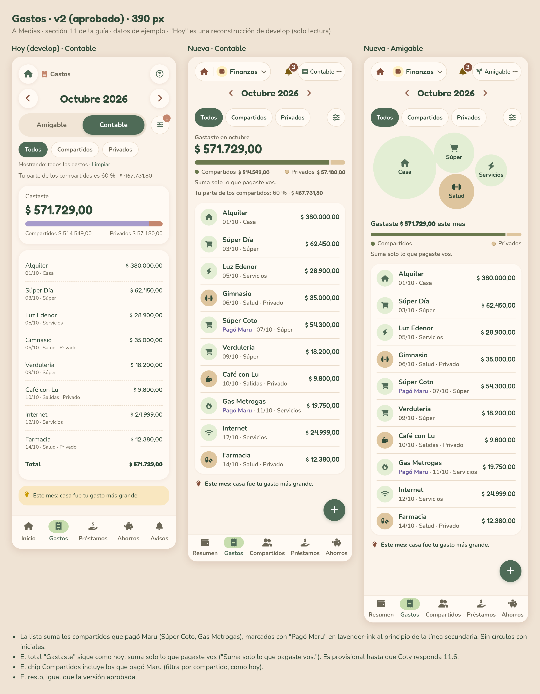 · 360: 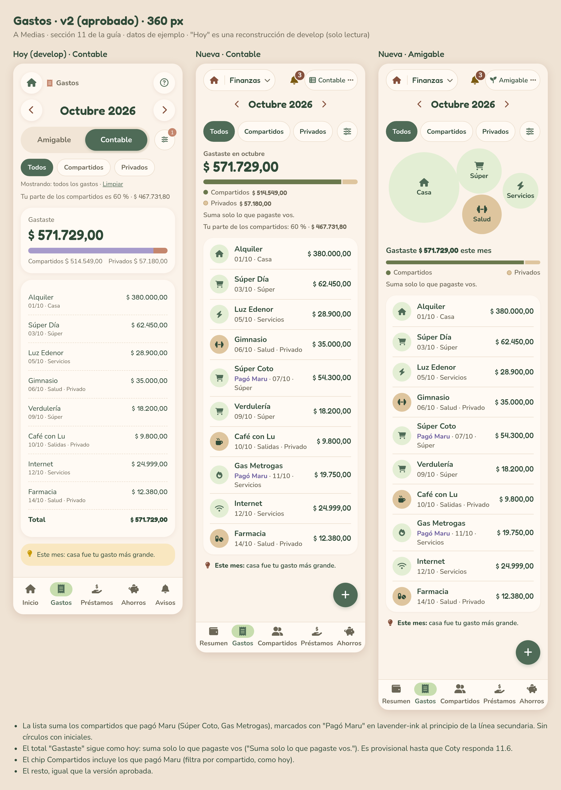

| Pantalla | 390 | 360 |
|---|---|---|
| Gastos, Contable | 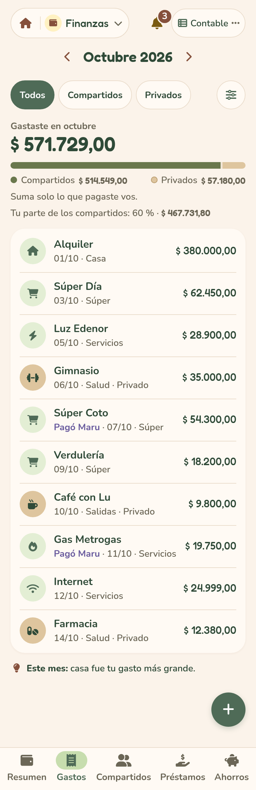 | 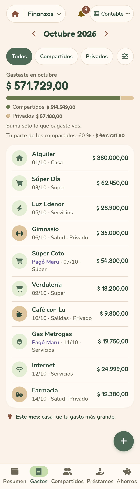 |
| Gastos, Amigable | 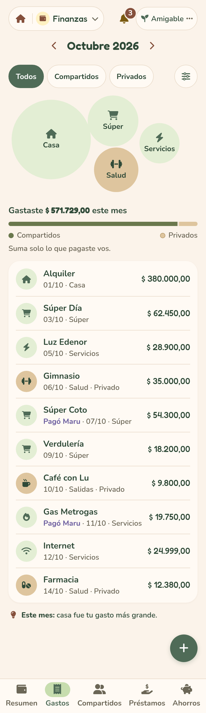 | 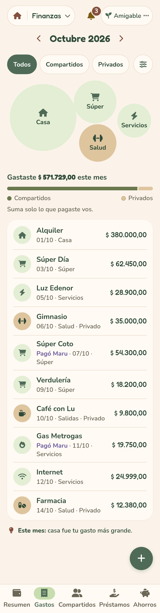 |

**Qué cambia en Gastos**
1. Encabezado de la sección 10: migas, campana y Opciones con el modo. Sale el `ViewToggle` y el título chico de `SectionHeader`.
2. Filtros en un solo renglón: chips Todos / Compartidos / Privados y el botón de filtros de 44 con número. Como hoy, la línea "Mostrando: … Limpiar" aparece solo con filtros activos.
3. Contable: el total va arriba de la lista, sin tarjeta (30 px), con una barra compartidos (`good`) / privados (`warn-soft`) y la leyenda con los dos montos. "Tu parte de los compartidos" queda en una línea.
4. La lista va en una sola tarjeta con líneas de 1 px. Se va la fila "Total" del final porque repetía el total de arriba.
5. Amigable: burbujas por categoría, después "Gastaste $X este mes" con la barra fina y la lista.
6. El consejo ("Este mes: … fue tu gasto más grande") pasa a una línea al final, sin tarjeta amarilla.
7. Botón flotante de 52 "Nuevo gasto". Gastos activo en la barra de Finanzas.
8. **Compartidos que pagó Maru (S12):** entran en la lista con la marca **"Pagó Maru"** al principio de la línea secundaria ("Pagó Maru · 07/10 · Súper"), en `lavender-ink` #6A5C9E Nunito 700 de 14 px. Es el mismo texto y color que en Compartidos (5.4, S2). Sin círculos con iniciales y sin cambiar el círculo de categoría. Los que pagaste vos no llevan marca, para que la fila quede liviana. La línea secundaria puede pasar a dos renglones a 360 para no cortar la marca.
   - **El chip Compartidos los incluye:** lo resuelve el código, porque `filterByScopeAndCategory` filtra por `isShared` y no por quién pagó.
   - **El total "Gastaste" suma solo lo que pagaste vos (S15),** como hoy, y debajo sigue "Suma solo lo que pagaste vos.". Para programar: hoy el total suma lo que muestra la lista (`visible`) y la lista trae solo lo tuyo (`loadPayerExpenses`); al sumar a la lista los que pagó Maru, el total, la barra, las burbujas y el consejo tienen que seguir contando solo lo tuyo.

**Privados en arena tostada (S9).** Token: **`warn-soft` (#DEC59E)**, que es la "arena tostada" de la paleta (P6). Por qué: se distingue de `sand` (fondos neutros) y de `sage-soft` (compartidos) sin usar `alert`, que en la app avisa de algo malo; en `develop` la barra pintaba los privados con `alert` y eso chocaba con P6. Uso: círculo del ícono y etiqueta "Privado" en `warn-soft` con texto e ícono en `title` (5,83:1). La barra contra `card` da 1,61:1, así que es decorativa (`aria-hidden`) y la información va en la leyenda y en la palabra "Privado" de cada fila: el color nunca es la única pista. `warn-ink` sobre `warn-soft` da 3,82:1 y no se usa para texto.

| Pantalla | 390 | 360 |
|---|---|---|
| Formulario, nuevo gasto (v4, con la ayuda de meses saldados) | 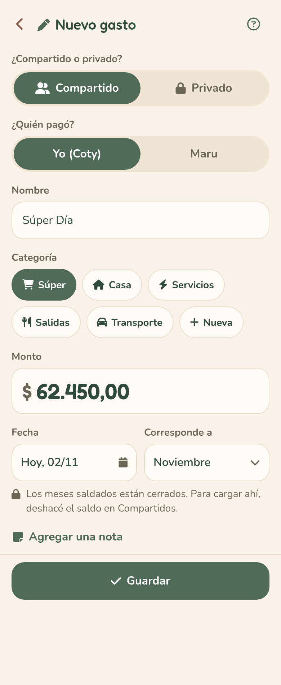 | 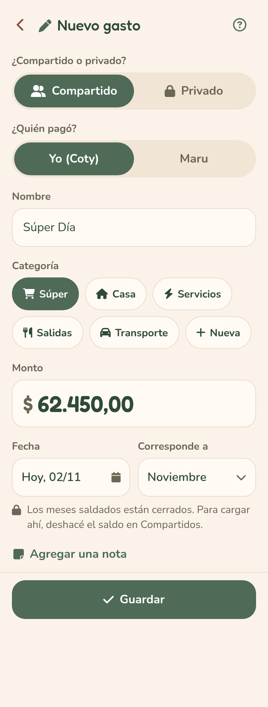 |
| "Corresponde a" con un mes saldado (v4) | 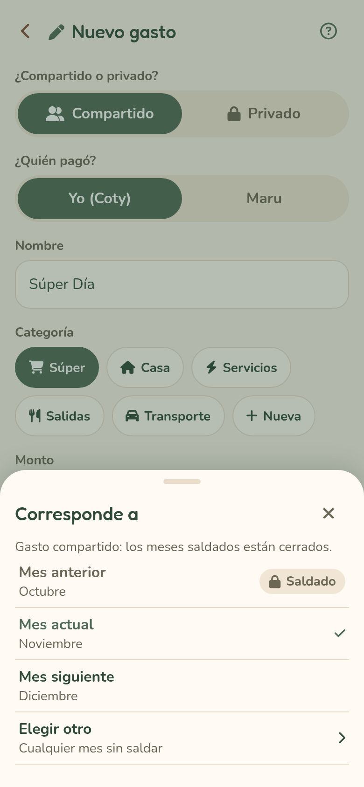 | 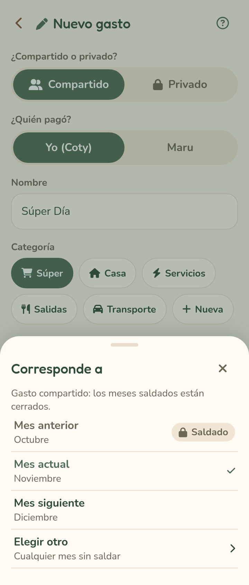 |
| Error: fecha futura (v3) | 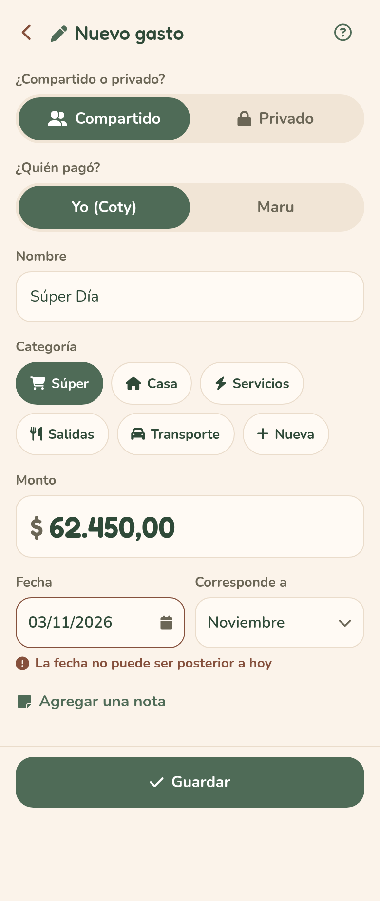 | 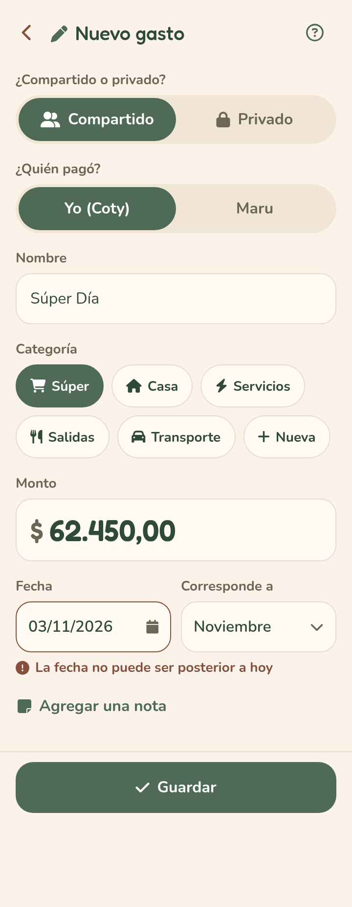 |
| Gasto de un mes saldado (v3) | 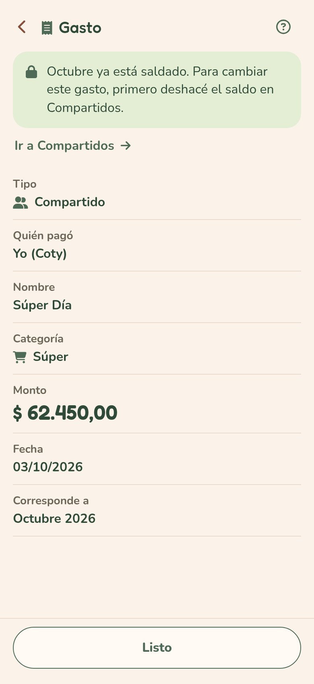 | 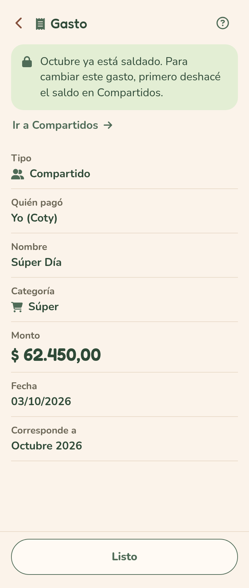 |
| Formulario, privado | 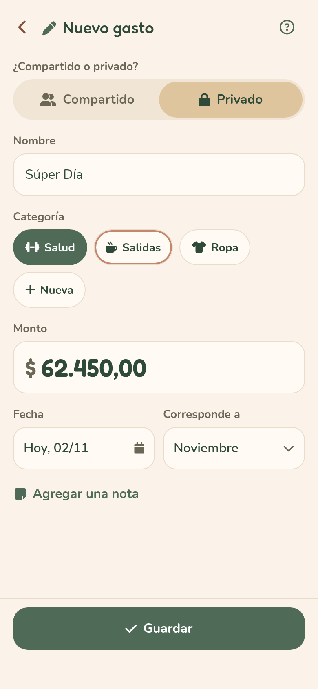 | 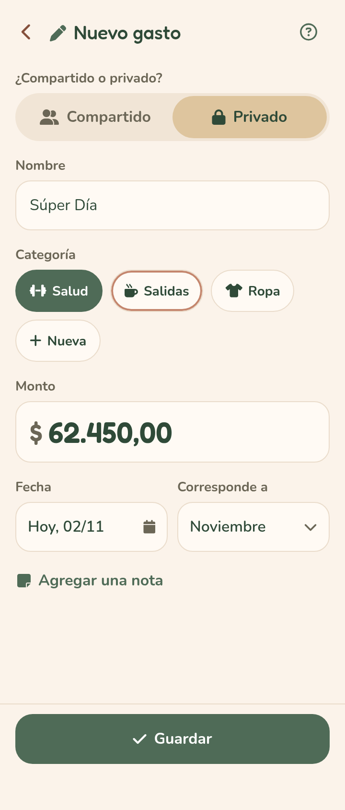 |

**Formulario: aprobado por Coty (S25).** **Qué cambia en el formulario** (tablero con la pantalla de hoy al lado: 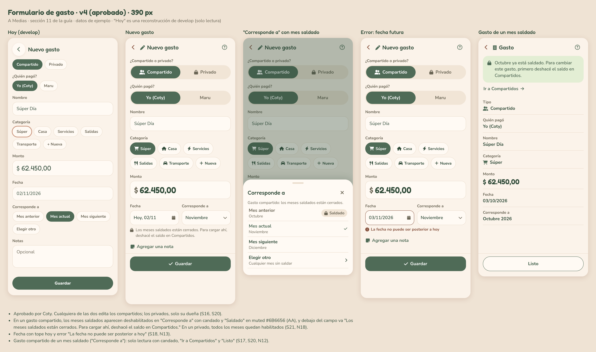 · 360: 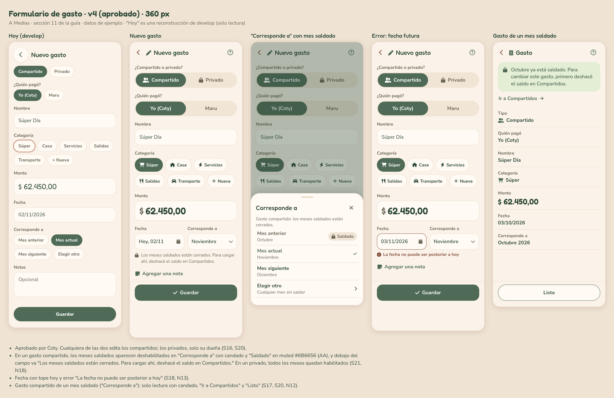)
1. Se mantiene el orden de `develop`: Compartido/Privado y ¿Quién pagó? (solo en compartido), después Nombre, Categoría y Monto; siguen Fecha, "Corresponde a" y Notas.
2. Compartido/Privado y ¿Quién pagó? pasan de chips a segmentos de 52. Privado activo en `warn-soft` con texto `title`.
3. Encabezado de segundo nivel: volver, "Nuevo gasto" y "?". Sin barra de navegación ni modo.
4. El monto va en grande (30 px). Fecha y "Corresponde a" comparten renglón; "Corresponde a" pasa de 4 chips a un selector con las mismas opciones (Mes anterior, Mes actual, Mes siguiente, Elegir otro).
   - **Meses saldados (S21; decisión de diseño de Art Attack, N18):** en un gasto compartido, el selector muestra los meses saldados deshabilitados, con candado y la etiqueta "Saldado" en `muted` #6B6656 (AA, nunca gris claro). Debajo del campo va la ayuda "Los meses saldados están cerrados. Para cargar ahí, deshacé el saldo en Compartidos.". "Elegir otro" tampoco deja elegir un mes saldado. En un privado, todos los meses quedan habilitados.
5. Notas queda detrás de "Agregar una nota" (el campo no cambia).
6. **Guardar de 52, fijo abajo**, siempre visible sobre el teclado. Los avisos de `develop` de precarga y de pagado desde la bolsa, y las confirmaciones de borrar y descartar, no cambian. El aviso "Lo cargó otra persona…" sale (S16).
7. La categoría sugerida conserva el anillo `alert` cuando no está elegida.
8. Al editar: título "Editar gasto", "Guardar cambios" y, debajo, "Eliminar" con borde `alert-ink` y confirmación, como hoy. En un compartido lo ve cualquiera de las dos; en un privado, solo su dueña (S16, S20). No aparece en un gasto compartido de un mes saldado (punto 10). **Decisión de diseño (Art Attack), N19:** se mantiene la confirmación de hoy ("¿Eliminar este gasto? No se puede deshacer."); M20 queda descartada.
9. **Fecha con tope hoy (S18).** El selector no deja elegir días futuros (`max` = hoy; hoy `develop` no tiene tope).
   - **Decisión de diseño (Art Attack):** si igual llega una fecha futura (por ejemplo, del comprobante), debajo del campo va "La fecha no puede ser posterior a hoy" en `alert-ink` con el ícono `circle-exclamation`, y el borde del campo en `alert-ink`. Se marca al tocar Guardar, como los otros obligatorios. "Mes siguiente" sigue en "Corresponde a", porque es el período y no la fecha.
10. **Gasto compartido de un mes saldado (S17; el mes es el de "Corresponde a", S20).**
   - **Decisión de diseño (Art Attack):** arriba, un aviso en `sage-soft` con candado: "Octubre ya está saldado. Para cambiar este gasto, primero deshacé el saldo en Compartidos."; debajo, el enlace de 44 "Ir a Compartidos". Todos los campos en solo lectura: texto en `title` #2F4A38, sin borde de campo, sin chevrones y sin el gris de deshabilitado. No hay Guardar ni Borrar: el botón fijo de abajo pasa a "Listo" (secundario) y cierra. El título dice "Gasto", no "Editar gasto".
   - Los privados no se bloquean por el saldo: la regla es solo para los compartidos.

**Revisión antes de programar (contra `develop`, `ExpenseEditor.tsx`, solo lectura).** Lo que ya resuelve el código y se mantiene:
- **Validaciones:** Nombre obligatorio ("Poné un nombre."), Categoría obligatoria ("Elegí una categoría.") y Monto mayor a 0 ("El monto tiene que ser mayor a 0."). Los errores aparecen al tocar Guardar; el botón se ve atenuado pero se puede tocar para mostrarlos. Una categoría nueva pide nombre ("Poné un nombre para la categoría.").
- **Compartido por defecto** en un gasto nuevo; al editar, lo guardado.
- **"Quién pagó" por defecto:** vos ("Yo (Coty)"); al editar, lo guardado.
- **Privado:** "Quién pagó" se oculta y se guarda siempre que pagaste vos. Un gasto pagado con la bolsa es siempre privado y no muestra el selector ("Pagado con la bolsa. Sigue siendo privado.").
- **Categorías:** en compartido, las de la casa; en privado, solo las tuyas. Si cambiás de tipo y la categoría no corresponde, se vacía. La sugerida por el comprobante va con anillo.
- **Fecha por defecto:** hoy, o la del comprobante; si no pudo leerla, deja hoy y avisa ("No pude leer la fecha. Dejé la de hoy para que la corrijas.").
- **"Corresponde a":** por defecto, el mes de la fecha, y lo sigue mientras no lo toques. Opciones: mes anterior, actual y siguiente (respecto de hoy) y "Elegir otro" (cualquier mes).
- **Borrar y descartar:** Borrar pide confirmación ("¿Eliminar este gasto? No se puede deshacer."); salir con cambios, también ("¿Descartar este gasto?").
- **Notas:** opcionales, recortadas al largo máximo (`clampNotes`).

**Cambios de comportamiento para programar (S16 a S18, S20, S21),** contra lo que hace hoy `develop` (leído en solo lectura en `ExpenseEditor.tsx`):
- **Quién edita (S16, S20):** compartidos, cualquiera de las dos; privados, solo su dueña. **Hoy:** `readOnly = expense.ownerId !== profile.id` deja en solo lectura todo lo que cargó la otra, compartido o no, con "Lo cargó otra persona. Podés verlo, no cambiarlo.". **Cambia:** `readOnly` pasa a ser `!expense.isShared && expense.ownerId !== profile.id` (o el bloqueo por saldo de abajo); ese aviso sale.
- **Bloqueo por "Corresponde a" (S17, S20):** un gasto compartido cuyo período ("Corresponde a") está saldado se abre en el estado del punto 10, sin Guardar ni Eliminar. **Hoy:** el formulario no mira si el mes está saldado.
- **Cargar o mover a un mes saldado (S21, N18):** en un compartido, los meses saldados quedan deshabilitados en "Corresponde a" (también en "Elegir otro") y el guardado lo rechaza si igual llega uno. Vale al cargar y al cambiar el período o pasar un privado a compartido. **Hoy:** los chips Mes anterior / Mes actual / Mes siguiente y "Elegir otro" (`input type="month"`) aceptan cualquier mes. Un `input type="month"` nativo no puede deshabilitar meses sueltos: hace falta una lista propia.
- **Fecha (S18):** el campo de fecha lleva `max` = hoy y la validación rechaza fechas futuras. **Hoy:** sin `max`.
- **Eliminar (N19):** sin cambios: la confirmación de hoy.

Sin dudas abiertas (11.6).

### 11.2 Avisos (`/recordatorios`, `RemindersScreen.tsx`)

**Aprobado por Coty** (S10). Solo muestra los gastos fijos y el recordatorio diario (S14).

Tablero: 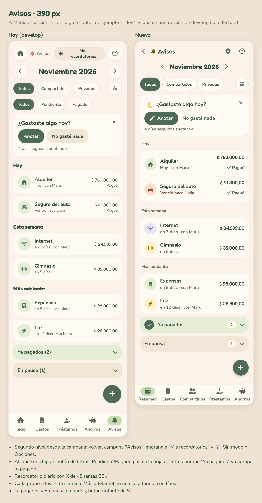 · 360: 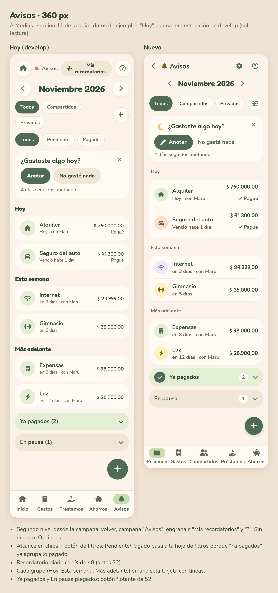

| Pantalla | 390 | 360 |
|---|---|---|
| Avisos | 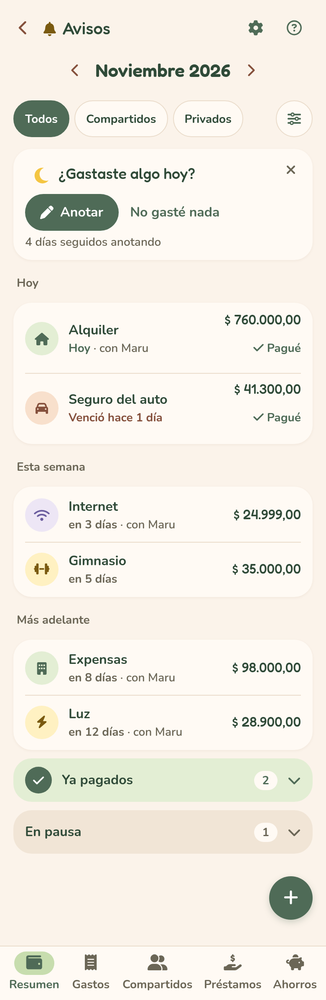 | 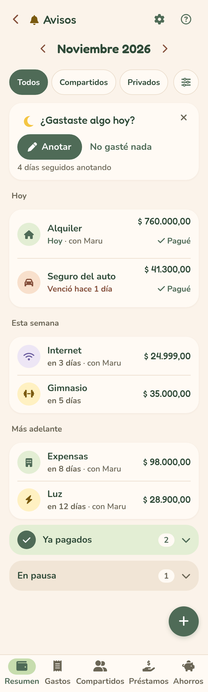 |

**Qué cambia**
1. Segundo nivel que se abre desde la campana (S6): volver, campana + "Avisos", engranaje "Mis recordatorios" (P13; en `develop` es `sliders`, ver M19) y "?". Sin toggle ni Opciones.
2. Mes de 22 con flechas.
3. Alcance en chips + botón de filtros. Pendiente / Pagado pasa a la hoja de filtros porque "Ya pagados" ya agrupa lo pagado; el número del botón cuenta los filtros activos.
4. Recordatorio diario "¿Gastaste algo hoy?" con la X de 48 (antes 32), "Anotar" como única acción llena y "No gasté nada" como enlace; la racha queda en una línea. Cerrarlo lo saca de la campana por ese día (S3).
5. Cada grupo (Hoy, Esta semana, Más adelante) en una sola tarjeta con líneas de 1 px. El vencimiento conserva los tonos de `develop`: hoy `primary`, pronto `muted`, vencido `alert-ink`. "Pagué" es un enlace de 44.
6. Ya pagados (`sage-soft`, número sobre `card`) y En pausa (`sand`) plegados. Botón flotante de 52 "Nuevo gasto fijo". En la barra queda activo Resumen, porque Avisos no es una pestaña (N6).

### 11.3 Ahorros (`/ahorros`, `SavingsScreen.tsx`) · Aprobado por Coty (S25) · solo Amigable

Tableros (v4, con la pantalla de hoy al lado): archivar 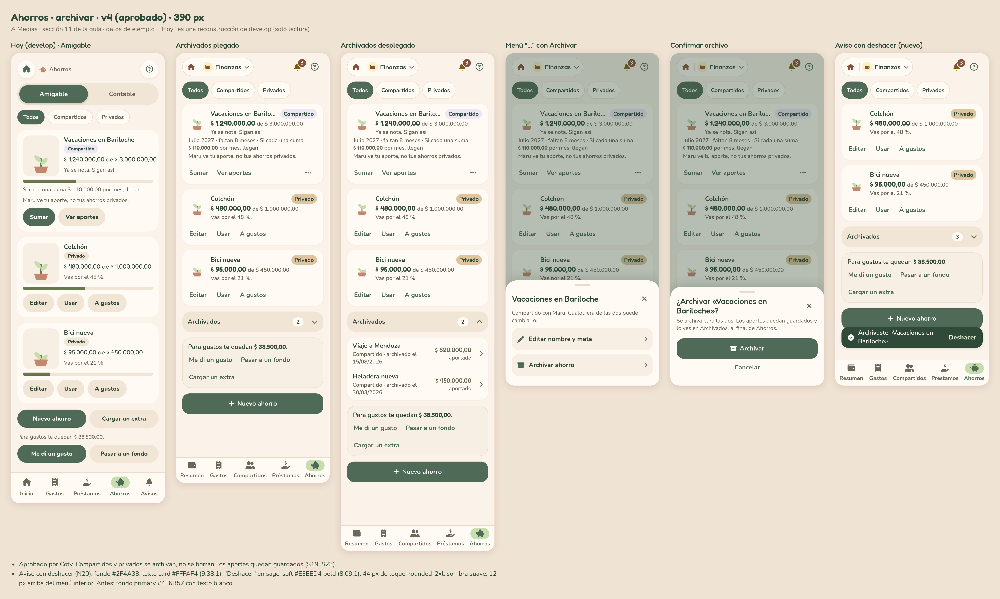 · 360: 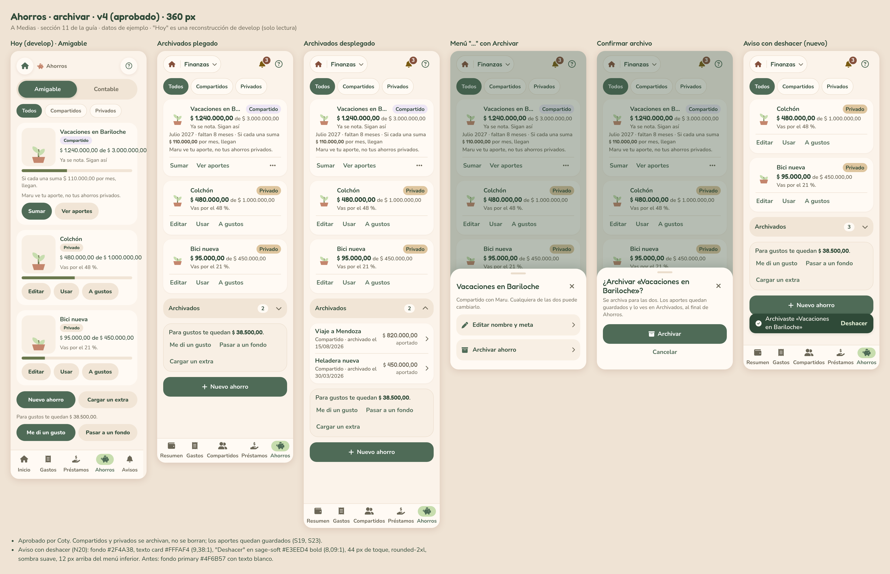; restaurar 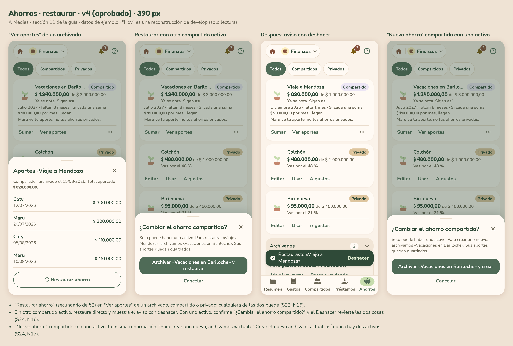 · 360: 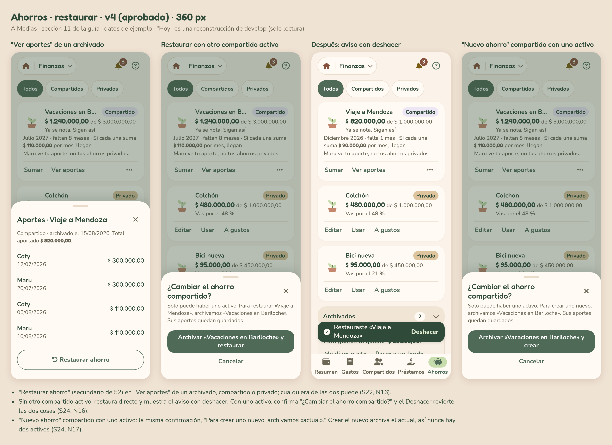

| Pantalla | 390 | 360 |
|---|---|---|
| Ahorros, Archivados plegado | 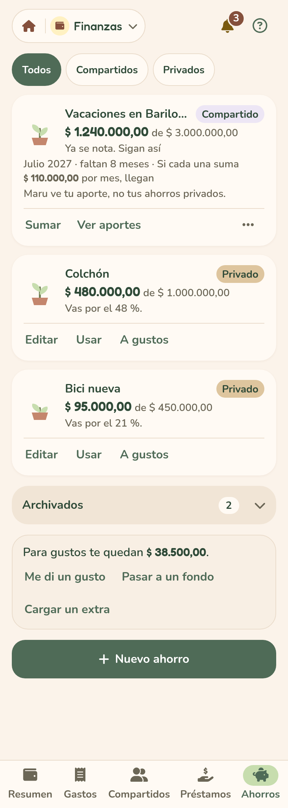 | 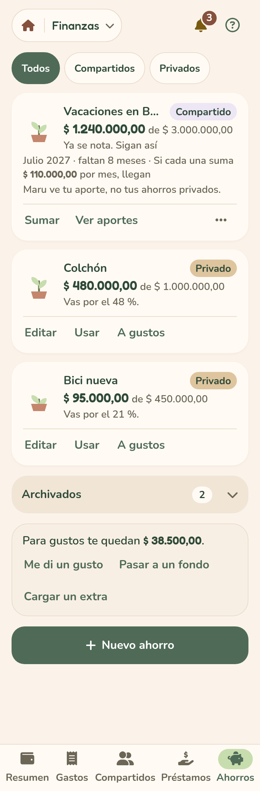 |
| Ahorros, Archivados desplegado | 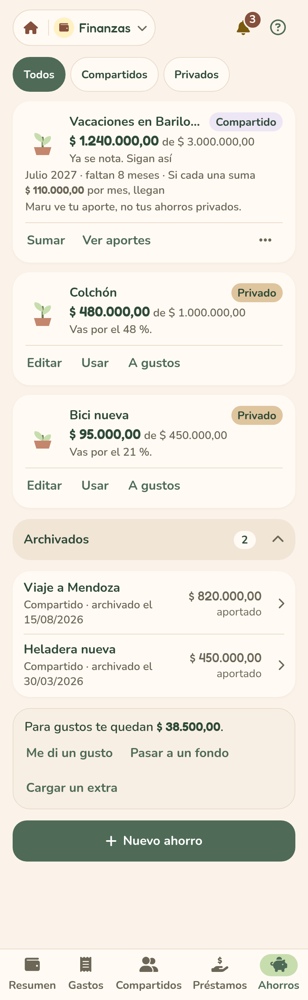 | 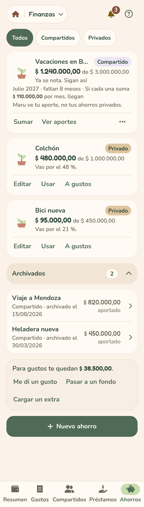 |
| Menú del ahorro compartido |  |  |
| Editar nombre y meta |  |  |
| Confirmar archivo |  |  |
| Después de archivar: aviso con deshacer (N20) |  |  |
| "Ver aportes" de un archivado, con Restaurar |  |  |
| Restaurar con otro compartido activo |  |  |
| Después de restaurar: aviso con deshacer |  |  |
| "Nuevo ahorro" compartido con uno activo |  |  |

La versión Contable (`s11-ahorros-contable-*`) queda **descartada** (S11).

**Qué cambia**
1. **Solo Amigable (S11).** El encabezado lleva migas, campana y el "?" de 44, que abre directamente "Cómo se lee esta pantalla" (N11). Sin botón Opciones.
2. Una sola lista con Todos / Compartidos / Privados (S7), como ya hace `develop`, con el filtro recordado.
3. Sale la planta de 92 × 104 y la barra de cada fila. Cada fila lleva una maceta de 44 px que crece con el avance, el nombre, la etiqueta (Compartido en `lavender-soft`, Privado en `warn-soft`), "$X de $Y" y la frase (`goalPhrase` en el compartido, "Vas por el N %." en los privados).
4. El compartido conserva el ritmo (`goalPaceLine`: "Julio 2027 · faltan 8 meses · Si cada una suma … por mes, llegan"), que `develop` muestra en los dos modos, y "Maru ve tu aporte, no tus ahorros privados.". Las acciones de los privados siguen siendo Editar, Usar y A gustos. Todas como enlaces de 44.
5. **Acciones del ahorro compartido (S13, S19):** Sumar y Ver aportes, como hoy, y al final de esa fila un botón "…" de 44 (`aria-label="Más acciones de <nombre>"`) que abre una hoja con:
   - **Editar nombre y meta:** una hoja con Nombre, Meta (monto) y "Para cuándo", y "Guardar cambios" como acción principal. Muestra lo ya ahorrado como referencia.
   - **Archivar ahorro (S19; decisión de diseño de Art Attack):** reemplaza a "Borrar ahorro". Ícono de caja (`box-archive`), en color normal, no `alert-ink`. Pide confirmación en una hoja (`alertdialog`): "¿Archivar «<nombre>»?", "Se archiva para las dos. Los aportes quedan guardados y lo ves en Archivados, al final de Ahorros.", con "Archivar" (principal) y "Cancelar". Después, el aviso con deshacer "Archivaste «<nombre>»" durante 6 s (4.15, N20), como "Saldar mes".
   - La hoja aclara "Compartido con Maru. Cualquiera de las dos puede cambiarlo.".
   - **Decisión de diseño (Art Attack):** menú de la tarjeta y no pantalla de detalle, porque son dos acciones poco frecuentes y la tarjeta ya muestra todo el detalle; el "…" no compite con Sumar.
6. **Archivados (S19).** **Decisión de diseño (Art Attack):** al final de la lista, un grupo plegado "Archivados (n)", con el mismo patrón que "Ya pagados" en Avisos; aparece solo si hay al menos uno. Cada fila muestra el nombre, el total aportado y la fecha de archivo en `muted`, sin maceta ni acciones de sumar. Tocar la fila abre "Ver aportes" (los aportes, en solo lectura). Los filtros Todos / Compartidos / Privados también se aplican a los archivados. Los privados también se archivan (S23). **Decisión de diseño (Art Attack):** el privado se archiva desde su hoja Editar, con "Archivar ahorro" al final, y la confirmación dice "¿Archivar «<nombre>»? Los aportes quedan guardados y lo ves en Archivados, al final de Ahorros." (sin "para las dos"). No está dibujado: reusa la hoja de confirmación del compartido.
   - **Restaurar (S22; decisión de diseño de Art Attack, N16):** en "Ver aportes" de un archivado, compartido o privado, va el botón secundario de 52 "Restaurar ahorro"; lo puede usar cualquiera de las dos. Si no hay otro compartido activo (o es privado), restaura directo y muestra el aviso con deshacer "Restauraste «<nombre>»". Si ya hay un compartido activo, confirma: "¿Cambiar el ahorro compartido?", "Solo puede haber uno activo. Para restaurar «<viejo>», archivamos «<actual>». Sus aportes quedan guardados.", con "Archivar «<actual>» y restaurar" (principal) y "Cancelar". Después, el aviso con deshacer revierte las dos cosas.
   - **Un solo compartido activo (S24; N17):** "Nuevo ahorro" compartido con uno activo abre la misma confirmación con "Para crear uno nuevo, archivamos «<actual>»." y "Archivar «<actual>» y crear". No contradice a Coty: se puede crear otro, y crearlo archiva el actual.
   - **Para programar, contra `develop`** (`SavingsScreen.tsx`, leído en solo lectura): hoy no hay borrar, archivar ni restaurar, ni para el compartido ni para los privados, así que todo eso es nuevo (estado "archivado" con fecha, sin perder los aportes). Hoy el código ya deja un solo ahorro compartido y bloquea crear otro; con S24 deja de bloquear y pasa por la confirmación de N17. Archivar, restaurar y el cambio de compartido los puede hacer cualquiera de las dos; los privados, solo su dueña.
7. Gustos en una caja `sand-soft`: "Para gustos te quedan $X." con Me di un gusto, Pasar a un fondo y Cargar un extra.
8. "Nuevo ahorro" es la única acción principal (antes había cuatro botones llenos).

### 11.4 Préstamos (`/prestamos`, `LoansScreen.tsx`) · Aprobado por Coty (S25) · solo Amigable

Tablero:  · 360: 

| Pantalla | 390 | 360 |
|---|---|---|
| Préstamos |  |  |

La versión Contable (`s11-prestamos-contable-*`, con el total neto y los chips de estado) queda **descartada** (S11).

**Qué cambia**
1. **Solo Amigable (S11).** Encabezado con migas, campana y el "?" de 44 que abre directamente "Cómo se lee esta pantalla" (N11). Sin botón Opciones.
2. Tarjetas en el celular (S8).
3. Total arriba: planta y `friendlyLoanSummary` ("Maru te debe $X en préstamos").
4. Filtros Todos / Pendientes / Saldados en chips.
5. Cada tarjeta: quién ("Le prestaste a Maru" / "Maru te prestó"), monto, fecha, nota, "Devuelto · falta" y "Registrar devolución" como enlace de 44 (o "Saldado").
6. Sin barras de progreso. "Nuevo préstamo" como botón principal.

### 11.5 Decisiones de diseño (Art Attack)

**Decisión de diseño (Art Attack).** Firmes, se implementan como están:
1. Modo solo en Gastos. Ahorros y Préstamos, solo Amigable (S11) con el "?" de 44 (N11). Sin modo en el formulario y en Avisos (N10).
2. Privados en `warn-soft` con texto `title`; la barra es decorativa y la leyenda lleva la información.
3. En Gastos se saca la fila Total del final y la tarjeta amarilla del consejo.
4. En Gastos, la marca "Pagó Maru" en `lavender-ink` al principio de la línea secundaria, solo en los gastos que pagó Maru (S12).
5. En el formulario, segmentos de 52, "Corresponde a" como selector, Notas detrás de un enlace y Guardar fijo.
6. En Avisos, Pendiente / Pagado va a la hoja de filtros y la X del diario pasa a 48.
7. En Ahorros, una maceta de 44 por fila (afina el principio 6 de 10.5: es el dato de avance, no un adorno), una sola acción principal y el menú "…" del compartido con Archivar, su confirmación y el toast (S13, S19, N14); los archivados en un grupo plegado al final (N15), con Restaurar en "Ver aportes" (N16) y un solo compartido activo (N17).
8. El chip "Saldado" y el número de "Ya pagados" no usan `sage-light` con `primary` (4,03:1): van en `sage-soft` o `card`.
9. En el formulario, un gasto compartido de un mes saldado se muestra en solo lectura con aviso de candado y "Listo" (N12), y la fecha tiene tope hoy con su error (N13); en un compartido, los meses saldados quedan deshabilitados en "Corresponde a" (N18). Borrar un gasto mantiene la confirmación de hoy (N19).
10. Todos los avisos temporales con "Deshacer" usan el estilo único de 4.15 (N20).

### 11.6 Dudas para Coty

**Cerradas:** quién edita el ahorro compartido (S13), qué avisos hay (S14), los gastos que pagó Maru en la lista (S12), el total "Gastaste" (S15), quién edita un gasto (S16, S20), el gasto de un mes saldado (S17, S20), la fecha futura (S18), el borrado del ahorro compartido (S19), cargar o mover a un mes saldado (S21), restaurar un archivado (S22), los ahorros privados (S23) y el nuevo compartido con uno activo (S24).

Sin dudas abiertas.
